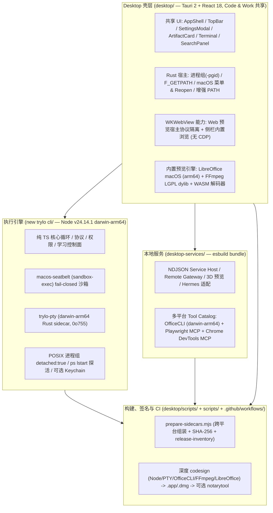
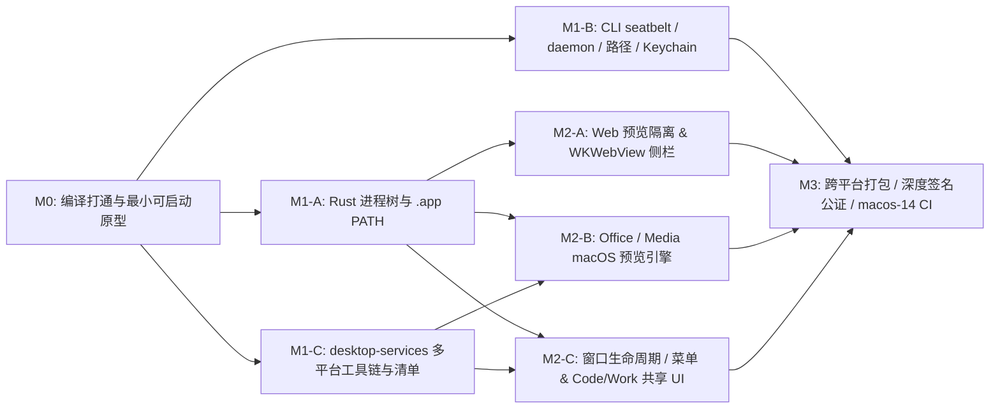

# Trylo Desktop macOS 版本整体开发计划（Plan）

- **状态**：已定稿（待按阶段进入实施）
- **基线版本**：Trylo Desktop `2.1.0` / Trylo CLI（`new trylo cli/`） / Desktop Services（`desktop-services/`）
- **目标平台**：macOS Apple Silicon（`darwin-arm64`），最低系统版本 **macOS 14 Sonoma**
- **适用范围**：全仓跨平台适配（`desktop/`、`new trylo cli/`、`desktop-services/`、`scripts/`、`.github/workflows/`、`docs/`）
- **遵守规范**：仓库根 [`AGENTS.md`](../../../AGENTS.md)、[`desktop/AGENTS.md`](../../../desktop/AGENTS.md)、[`desktop-services/AGENTS.md`](../../../desktop-services/AGENTS.md)、[`new trylo cli/AGENTS.md`](../../../new%20trylo%20cli/AGENTS.md)、[`trylo-code-quality`](../../../new%20trylo%20cli/.agents/skills/trylo-code-quality/SKILL.md) 与 [`ui-maintainability.md`](../../../new%20trylo%20cli/.agents/skills/trylo-code-quality/references/ui-maintainability.md)

---

## 1. 背景与目标

Trylo 2.0 曾由独立私有仓库构建过第一版 macOS Apple Silicon Beta，2.1.0 仅重新构建了 Windows x64。当前公开主仓具备良好的核心跨平台基础（Tauri 2、React 18、纯 TypeScript Node CLI、零原生 npm addon、NDJSON Service Host、WASM 预览解码器），但在 Rust 宿主、CLI 沙箱/PTY/后台任务、工具链 manifest、预览引擎与打包脚本上仍深度绑定 Windows x64，无法在 macOS 上直接编译、运行或发布。

本计划的目标是在**当前主仓库内**以一套源码、显式平台适配的方式，交付体验完整、权限链诚实、供应链可审计、可一键产出签名/公证 DMG 的 Trylo Desktop macOS 正式版本。

---

## 2. 已拍板的产品与架构决策

| 编号 | 决策领域 | 已定稿方案 | 关键影响与约束 |
| :--- | :--- | :--- | :--- |
| **D1** | **目标架构与系统基线** | 仅 **Apple Silicon (`darwin-arm64`)**，最低 **macOS 14 Sonoma** | 所有内嵌运行时与原生制品（Node、`trylo-pty`、`officecli`、LibreOffice、FFmpeg LGPL）按 `darwin-arm64` 单架构锁定；CI 固定 `macos-14` runner |
| **D2** | **仓库集成、CI 与签名公证** | **主仓原生跨平台代码 + GitHub Actions (`macos-14`) 自动构建 DMG**；签名与 Apple 公证通过可选 Secrets 参数化 | 无证书 Secrets 时可直接产出 ad-hoc 内部测试包并显式标注；配置 Apple Developer ID 与公证凭据后自动产出 Hardened Runtime + `notarytool` 公证正式 DMG |
| **D3** | **原生浏览器侧栏** | **能力分轨**：macOS 完整打通 Playwright MCP / Chrome DevTools MCP（驱动系统 Chrome 或 Playwright Chromium）与网页实时预览；原生浏览器侧栏用 **WKWebView** 提供内置浏览（后退/前进/刷新/缩放/Escape），不做 CDP 注入 | 不引入 CEF/内嵌 Chromium；`native_browser.rs` 在 macOS 基于 `objc2-web-kit` 接入 WKWebView 导航与事件监听，Agent 浏览器自动化统一走 Playwright/Chrome DevTools MCP |
| **D4** | **Windows 专属/重度原生能力** | **首期聚焦核心工作台**（Code & Work + CLI + 预览 + OfficeCLI + 浏览器 + Remote）；**电脑控制（Windows-MCP/WGC/实时电脑预览）、跨平台 CAD/EDA、桌面伙伴（WPF 桌宠）、软件工作区（Win32 `CreateDesktopW`）**首期清晰降级/隐藏，全部排入二期（M4） | macOS 打包移除 `desktop-companion`、`wgc-helper`、`windows-mcp-fork`；共享 UI（`TopBar`、`SettingsModal`）同步隐藏或禁用不支持项，绝不阻塞普通对话与工具调用 |
| **D5** | **文档与媒体预览引擎** | **内置优先 + 开发态清晰降级**：DMG 内置裁剪版 **LibreOffice macOS (`aarch64`)** 与 **LGPL FFmpeg `arm64` dylib**；开发态保留回退检测本机 `/Applications/LibreOffice.app` | 建立 `office-engine` 与 `media-engine` 多平台 lock 清单、macOS 供给/构建脚本、`@loader_path` rpath 修正、LGPL 源码/许可归档与嵌套二进制深度签名 |
| **D6** | **CLI 沙箱与凭据安全** | 首期实现完整 **`macos-seatbelt` (`sandbox-exec`)** 文件+网络隔离（严格对齐 `IsolationPort` fail-closed 契约）；凭据默认使用现有 **`0o600` 文件账本**，同步提供可选 **macOS Keychain (`/usr/bin/security`)** 驱动（显式开启或签名包优先使用） | 消除非 Windows 静默回退无沙箱运行与 5 处 `LOCALAPPDATA` 同步崩溃；避免未签名 ad-hoc 包反复触发系统钥匙串弹窗 |
| **D7** | **窗口形态与生命周期** | **【已于 2026-11-26 由 Overlay 标题栏 + 原生 Vibrancy 方案替代（Superseded）】** 原 D7 基线曾定稿保留标准 macOS 原生标题栏（首期零布局冲突，确保 Code & Work 稳定）；现按 2026-11-26 macOS 原生桌面体验升级方案演进为：`titleBarStyle: "Overlay"` + `hiddenTitle: true` + `trafficLightPosition`（全屏自动收起左侧预留间距）+ `Effect::Sidebar` 侧栏毛玻璃与 `followsWindowActiveState` 非激活态降饱和、46px 统一顶栏与 Code/Work 共享 `NSSegmentedControl`、`html/body/#root` 透明配对原生 `NSScroller` 覆盖滚动条、System Settings 风格设置面板与 `⌘K` Spotlight 命令面板；继续保留**红叉关闭主窗仅隐藏窗口**、点击 Dock 重开（`RunEvent::Reopen`）、**`Cmd+Q` / 菜单退出**执行幂等 `shutdown_all()` 清理全部子进程 | 补齐完整 macOS 标准应用菜单（Trylo/Settings `Cmd+,`、File `Cmd+N`/`Cmd+O`/`Cmd+W`、Edit `Cmd+C/V/X/A/Z`、View `Cmd+K`/`Cmd+B`/`Shift+Cmd+B`/Fullscreen、Window、Help）与原生主题同步，在主窗、Code/Work 与子 WebView 正常生效 |

---

## 3. 全栈总体架构与当前缺口映射

### 3.1 现状盘点（已就绪 vs 阻断项）

| 工程 | 已有跨平台基础 | macOS 主要阻断项 |
| :--- | :--- | :--- |
| **`desktop/src-tauri/`** | `cfg(windows)` 已隔离 Win32 crate；`libc` 已锁定；`node_runtime.rs` 已含 `darwin-arm64/x64`；`icon.icns` 合法存在 | `warnings = "deny"` 下 4 处编译失败；`remote_artifact_policy.rs` 缺 `F_GETPATH`；`host_protocols.rs`/`office_engine.rs`/`media/engine.rs`/`native_browser.rs` 硬拒绝非 Windows；非 Windows 停止只杀根 PID 漏杀子进程；`.app` 缺少 Homebrew `PATH` 解析 |
| **`desktop/src/`** | `AppShell`/`TopBar`/`SettingsModal`/`ArtifactCard` 已由 Code 与 Work 共享；基础路径拼接兼容 POSIX | `Terminal.tsx` 硬编码 `'bash.exe'`；`ArtifactCard.tsx` 混用 Windows 可执行名（`winword`/`excel`）；`SearchPanel.tsx` 缺 `Cmd+Shift+F`；Windows 字体栈与 `D:/CC/trylo` 默认路径；`SettingsModal` 误标 `chrome-devtools` 为 Windows-only，而 `TopBar` 无条件露出 Windows 专属入口 |
| **`new trylo cli/`** | 0 原生 npm addon；主循环/协议/LSP/Git/Worktree/`0o600` 凭据账本已跨平台；`IsolationPort` 已声明 `macos-seatbelt` | 打包脚本硬绑定 `srt-win-*.exe` 与 `trylo-pty.exe`；`trylo-pty` 未建 `darwin-arm64`；5 处学习/工具调用无条件读 `LOCALAPPDATA` 崩溃；`run_shell` 非 Windows 静默回退无沙箱；管道后台会话缺 `detached: true` 导致 `kill(-pid)` 失效；`daemon`/`bg` 缺 POSIX 探活与树杀；全局 symlink 执行 `trylo` 静默退出；`locateNpmCli` 找不到 `../lib/node_modules/npm` |
| **`desktop-services/`** | Service Host 主循环、3D 预览、Remote Gateway、Playwright/Chrome DevTools JS 服务器跨平台 | 10 个 manifest 锁死 `platform: 'win32-x64'`；`python.exe` 硬编码；浏览器探测缺 `~/Library/Caches/ms-playwright` 与 `chrome-mac-arm64`；`shadow-runner.mjs` 用裸 `'node'`；`uv`/`cloudflared` 缺 `/opt/homebrew/bin`；`release-inventory.mjs` 强校验 WPF 桌宠/WGC/Windows-MCP |
| **`desktop/scripts/` & `scripts/`** | `stage-npm.mjs`、`start-desktop-dev.mjs`、`workspace-layout.mjs` 跨平台 | `beforeBuildCommand` 硬调 PowerShell `prepare-sidecars.ps1`；`stage-cli.mjs` 与 Node 固定包硬编码 `win-x64/node.exe`；`tauri.conf.json` 仅配 `nsis`；`render_brand_icons.py` 的 `write_icns()` 会写坏 `icon.icns`；`setup-repository-tools.mjs` 存在旧 `new_tool/` 路径 |

---

## 4. 工程红线与质量门禁

所有 macOS 改动必须满足仓库宪法与 `$trylo-code-quality` 门禁：

1. **Code & Work 双模式同步**：任何前端 UI、快捷键、能力提示、外部应用打开或窗口行为改动，必须在共享组件及真实调用入口中同步覆盖 Code 与 Work，并成对验证。不得出现一侧已适配 macOS、另一侧仍残留旧交互或报错。
2. **权限链与禁止防御性编程**：
   - 用户选择的权限模式（自动/审批/只读）必须从 Desktop 宿主完整贯穿至 CLI 参数、`macos-seatbelt` 沙箱、工具分类器与实际子进程。
   - 缺失可选平台能力（桌宠、电脑控制、软件工作区）只影响自身入口，绝不得锁死普通对话或常规工具调用。
   - `IsolationPort` 严格遵循 fail-closed：未配置或沙箱不可用时明确返回类型化失败，不得静默伪装为“已在沙箱内执行”。
3. **供应链与许可证闭环**：

| 新增 / 替换制品 | 来源与固定方式 | 许可证与合规处理 | 隔离与替换边界 |
| :--- | :--- | :--- | :--- |
| **Node.js `v24.14.1` (`darwin-arm64`)** | 官方 tarball + 固定 SHA-256，落位 `resources/runtime/node/darwin-arm64/bin/node` | MIT，随包保留 `NODE-LICENSE.txt` | 仅由 `node_runtime.rs` 与打包脚本解析 |
| **`trylo-pty` (`darwin-arm64`)** | 本仓 `new trylo cli/vendor-bin/pty/` 源码编译 + 写入 `PROVENANCE.json` SHA-256 | 本仓自有 Rust 代码（依赖 `portable-pty`/`serde`/`serde_json` 均已审计） | 由 `pty-loader.ts` 加载，协议 v2 |
| **`officecli` (`darwin-arm64`)** | `iOfficeAI/OfficeCLI` 固定 release tag 资产 + SHA-256（或源码 `-r osx-arm64` 构建） | 随包保留上游 `LICENSE`/`NOTICE` | 通过 `tool-catalog.mjs` 多平台 manifest 隔离 |
| **LibreOffice macOS (`aarch64`)** | Document Foundation 官方固定版 `.dmg` + `codesign` 验签 + 裁剪清单与 SHA-256 | MPL-2.0，保留官方源码链接与许可声明 | 仅由 `preview/office_engine.rs` 与 `supply-office-engine.mjs` 访问 |
| **FFmpeg `arm64` dylib** | 由 `media-build/macos.sh` 从固定版本源码以 `--enable-shared --disable-gpl` 编译 + SHA-256 | LGPL-2.1+，按 `desktop/docs/preview/media.md` 归档源码说明与许可文本 | 仅由 `preview/media/engine.rs` 按 `@loader_path` 调用 |
| **Rust macOS 绑定 (`objc2` / `objc2-web-kit`)** | `[target.'cfg(target_os = "macos")'.dependencies]` 精确锁版本 | MIT，核对传递依赖闭包并补齐 `licenses/` 与 NOTICE | 仅限 `commands/native_browser.rs` 与 `preview/web/host_protocols.rs` 的 macOS 分支 |

4. **目录纪律**：所有临时验证日志、截图、探针脚本、候选快照统一写入仓库根 `_workspace/tasks/` 或 `_workspace/artifacts/`；每次阶段交付均须保证 `node scripts/check-workspace-layout.mjs` 通过。

---

## 5. 分阶段施工蓝图（M0 → M3）

### 阶段依赖关系

---

### Phase 0（M0）：编译打通与最小可启动原型（Dev Smoke）

**目标**：消除全部 macOS 编译错误与启动即崩问题，使 `new trylo cli`、`desktop-services`、`desktop/src-tauri` 在 `macos-14` 上编译通过并能拉起原生开发窗完成基础对话与工具审批闭环。

#### WP-M0.1：Desktop Rust 编译与安全阻断修复
- **改动文件**：
  - `desktop/src-tauri/src/commands/process_spawn.rs`：在 `#[cfg(unix)]` 下引入 `std::os::unix::process::ExitStatusExt`；修正 `tree_owner` 在非 Windows 下的 `unused_variables`。
  - `desktop/src-tauri/src/commands/work_host.rs`：为 macOS `launch_with_app` 增加应用名安全校验（兼容带空格的 macOS 应用名如 `"Microsoft Word"`），消除 `is_safe_app_identifier` 的 `dead_code` 告警；同步将 `work_host_show_in_folder` 的 macOS 实现改为 `open -R <target>` 在 Finder 中高亮选中文件。
  - `desktop/src-tauri/src/commands/lsp_config.rs`：非 Windows 分支 `.map(...).unwrap_or(false)` 改为 `.is_ok_and(...)` 以满足 `clippy::pedantic`。
  - `desktop/src-tauri/src/commands/remote_artifact_policy.rs`：新增 `#[cfg(target_os = "macos")]` 的 `opened_path` 实现（`libc::fcntl(fd, libc::F_GETPATH, ...)`）并保持 `O_NOFOLLOW` TOCTOU 防护。
  - `desktop/src-tauri/src/commands/pick_folder.rs`：将遗留 PowerShell `Shell.Application` 实现收敛到 `#[cfg(windows)]`（或确认无消费者后安全清理，前端已统一走 `tauri-plugin-dialog`）。
- **不变量**：`cargo clippy --all-targets -- -D warnings` 在 Windows 与 macOS 均零告警；远端产物读取继续坚持句柄路径一致性校验。

#### WP-M0.2：Desktop 前端最小启动修复
- **改动文件**：
  - `desktop/src/components/product-ui/Terminal.tsx`：移除硬编码 `DEFAULT_SHELL = 'bash.exe'`，改为按平台选择默认 shell（macOS 由后端或平台默认解析 `$SHELL` / `/bin/zsh`，Windows 保持不变）。

#### WP-M0.3：CLI 最小可构建与可运行改造
- **改动文件**：
  - `new trylo cli/vendor-bin/pty/src/main.rs` & `new trylo cli/vendor-bin/pty/PROVENANCE.json`：补齐 POSIX 基础环境变量保留（`TERM`、`HOME`、`TMPDIR`、`LANG`/`LC_ALL`）；在 macOS `arm64` 构建 `vendor-bin/pty/darwin-arm64/trylo-pty` 并记录字节数与 SHA-256。
  - `new trylo cli/scripts/pty/copy-pty-vendor.mjs` & `new trylo cli/src/internal/adapters/process-session/pty-loader.ts`：非 Windows 目标去除 `.exe` 后缀并在 staging 时执行 `chmod(dest, 0o755)`；同步更新二者路径一致性的契约测试。
  - `new trylo cli/scripts/copy-vendor.mjs`、`new trylo cli/scripts/release-inventory.mjs`、`new trylo cli/scripts/skill-learning/build-candidate.mjs`：按目标平台条件校验与拷贝原生沙箱/PTY 产物（macOS 不再强制要求 `srt-win-*.exe`）。
  - `new trylo cli/src/internal/adapters/sandbox/` + 5 个调用点（`src/cmd/trylo/tool-production-service.ts`、`src/internal/surface/cli/tool-production-wiring.ts`、`src/internal/surface/cli/tool-evolution-execution.ts`、`src/internal/surface/cli/commands-tool-use.ts`、`src/internal/learning/agent/subsystems/check/adapters/execution/checker-executor.ts`）：抽取统一平台 `IsolationPort` 工厂，避免在 macOS 上因缺少 `LOCALAPPDATA` 同步抛出异常。
  - `new trylo cli/src/cmd/trylo/main.ts` & `new trylo cli/src/cmd/trylo/central-runtime-main.ts`：入口判定前对 `process.argv[1]` 做 `realpathSync`，修复 macOS 全局 symlink 调用静默退出的问题。

#### M0 出口验收
- `node scripts/check-workspace-layout.mjs` 通过
- `new trylo cli`：`npm run build && npm run verify` 在 macOS 通过（含 `trylo-pty` `darwin-arm64` 真实 PTY 冒烟）
- `desktop`：`pnpm typecheck && pnpm lint && pnpm test` 通过；`src-tauri` 在 `macos-14` 上 `cargo clippy --all-targets -- -D warnings && cargo test` 通过
- `pnpm tauri:dev` 在 macOS 启动主窗，Code 与 Work 均可打开目录、打开集成终端、运行一次新 CLI 对话与审批闭环

---

### Phase 1（M1）：核心运行时、进程治理、`macos-seatbelt` 沙箱与本地服务闭环

**目标**：让 macOS 的进程树清理、命令沙箱、后台任务与核心本地服务（OfficeCLI、Playwright、Chrome DevTools、Hermes、Remote Gateway）达到生产级可靠性。

#### WP-M1.1：Rust 进程树治理与 `.app` 增强 `PATH`
- **改动文件**：
  - `desktop/src-tauri/src/commands/process_spawn.rs`、`process_termination.rs`、`servicehost.rs`、`servicehost_termination.rs`：Unix/macOS 子进程通过 `CommandExt::process_group(0)` 独立建组；终止时先发 `SIGTERM` 给 `-pgid`，短宽限后再发 `SIGKILL` 给 `-pgid`，防止 MCP 服务与子 shell 泄漏成孤儿进程。
  - `desktop/src-tauri/src/commands/process_team_guard.rs`：实现 Unix/macOS 进程组追踪与 drop/shutdown 自动回收。
  - 新增共享可执行路径解析辅助模块，接入 `commands/search.rs`（`rg`）、`commands/git_*.rs`（`git`）与 `commands/lsp_config.rs`：在 macOS GUI `.app` 极简 `PATH` 下按确定顺序补充探测 `/opt/homebrew/bin`、`/usr/local/bin`、`~/.local/bin`、`~/.cargo/bin`；缺失时返回清晰可操作错误，不静默失败。

#### WP-M1.2：CLI `macos-seatbelt` 沙箱、`daemon`/`bg`、路径修复与可选 Keychain
- **改动文件**：
  - 新增 `new trylo cli/src/internal/adapters/sandbox/macos-isolation.ts`（及契约测试）：实现 `IsolationPort` 的 `macos-seatbelt` 后端，调用 `/usr/bin/sandbox-exec -f <profile>` 生成最小权限 SBPL profile（默认拒写仅放行 workspace + `TMPDIR`，强制执行 `denyReadPaths` / `denyWritePaths` 与 `network` 出网限制）。
  - `new trylo cli/src/internal/surface/cli/run-execution-wiring.ts`：移除 `platform === "win32"` 专判，在 macOS 下当 `shellIsolation !== "host"` 时接入 `macos-seatbelt` 边界，杜绝静默无沙箱执行。
  - `new trylo cli/src/internal/adapters/process-session/session-registry.ts`：非 Windows 管道后台会话补充 `detached: true`，修复 `kill(-pid)` 因 `ESRCH` 静默无效的缺陷。
  - `new trylo cli/src/internal/adapters/process-session/process-tree.ts`：优化 `terminatePosixGroup`，监听退出或短轮询替代死等 2000ms 宽限期。
  - `new trylo cli/src/internal/adapters/daemon/identity-probe.ts` & `process-session/terminate-by-pid.ts`：实现 macOS `ps -o lstart= -p <pid>` 进程身份校验与 POSIX 进程组终止，恢复 `trylo daemon` 与 `trylo bg ps|logs|attach|kill`。
  - 细节修复：
    - `src/internal/learning/agent/subsystems/tool/adapters/acquisition/npm-lock-resolver.ts`：支持 `<prefix>/lib/node_modules/npm/bin/npm-cli.js` 并透传 `TMPDIR`。
    - `src/internal/surface/cli/hermes-skill-client.ts`：macOS 默认存储路径对齐 `~/Library/Application Support/me.trylocode.trylo/Trylo`。
    - `src/internal/adapters/sandbox/resolve-executable-path.ts`、`shell-detect.ts`、`executable.ts`：POSIX 校验 `X_OK` 执行位、去掉非 win32 `.COM/.EXE/.BAT/.CMD` 拼接、清理多余 `env["Path"]`、补充 `/opt/homebrew/bin/pwsh` 候选。
    - `src/cmd/trylo/main.ts`：正确拆分带参数的 `$VISUAL`/`$EDITOR`（如 `code --wait`）。
    - `src/internal/adapters/tools/shared/workspace.ts` & `quarantine/acquire.ts`：Windows 保留设备名检查仅在 `win32` 生效；隔离根目录禁区纳入 `~/Library/Application Support`；补充默认大小写不敏感 APFS 下的路径规范化测试。
  - 新增 `new trylo cli/src/internal/adapters/credentials/keyring-darwin.ts` 并接入 `keyring-compose.ts`：基于 `/usr/bin/security` 实现 macOS Keychain 驱动；默认继续使用已有 `0o600` 文件账本，仅在显式 `TRYLO_PREFER_KEYRING=1` 或签名包配置时优先启用。

#### WP-M1.3：`desktop-services` 跨平台工具链与本地服务
- **改动文件**：
  - `desktop-services/src/tooling/tool-catalog.mjs` 与首批跨平台 manifest（`manifests/officecli.mjs`、`manifests/playwright.mjs`、`manifests/chrome-devtools.mjs`）：扩展 manifest schema 支持按平台（`darwin-arm64` / `win32-x64`）解析 `artifact` 与下载校验，接入 `officecli` `darwin-arm64` 固定资产与 SHA-256。
  - `desktop-services/src/tooling/tool-health-service.mjs` & `tool-runtime-identity.mjs`：将硬编码 `python.exe` 与 `Lib/site-packages` 改为按平台分派（POSIX 用 `bin/python`、`lib/python*/site-packages`）。
  - `desktop-services/src/tooling/tool-browser-condition.mjs`、`viewport-bridge.mjs`、`stop-viewport-process.mjs`：新增 macOS 缓存路径 `~/Library/Caches/ms-playwright`、`chrome-mac-arm64`/`chrome-mac`、`Google Chrome for Testing.app/Contents/MacOS/Google Chrome for Testing` 检测与进程组终止。
  - `desktop-services/src/learning/shadow-runner.mjs`：改用 `process.execPath` 替代裸 `'node'`。
  - `desktop-services/src/tooling/tool-package-manager.mjs` & `desktop-services/vendor/legacy/remote-tunnel.js`（同步登记 `vendor/PATCHES.md`）：补充 `/opt/homebrew/bin/uv` 与 `/opt/homebrew/bin/cloudflared`。
  - `desktop-services/scripts/release-inventory.mjs` & `verify-remote-runtime.mjs`：Windows 专属校验项（`TryloDesktopPet.exe`、`trylo-wgc-helper.exe`、`windows-mcp-fork`）按 `process.platform === 'win32'` 条件门禁；macOS 下强校验 `runtime/node/darwin-arm64/bin/node` 与 macOS npm 闭包。

#### M1 出口验收
- `macos-seatbelt` 探针证明：越界写入被拒绝、禁读路径被拒绝、禁用网络时直连 TCP 被拒绝、允许路径正常执行
- 停止/打断测试证明：取消运行中命令与停止 Service Host 后，无残余子进程存活，且同一对话可继续推进
- `trylo daemon` / `trylo bg`、`officecli` MCP、`playwright` MCP、`chrome-devtools` MCP、Remote Gateway 在 macOS 真机/CI 均通过实跑检查

---

### Phase 2（M2）：三大预览引擎、WKWebView 浏览器侧栏与 macOS 原生体验（Code & Work 同步）

**目标**：网页实时预览、高保真 Office 预览、媒体转码预览、WKWebView 原生浏览器侧栏以及全部 macOS 交互细节在 Code 与 Work 双模式对齐落地。

#### WP-M2.1：Web 实时预览协议隔离 & WKWebView 原生浏览器侧栏
- **改动文件**：
  - `desktop/src-tauri/Cargo.toml`：在 `[target.'cfg(target_os = "macos")'.dependencies]` 下引入锁定版本的 `objc2` / `objc2-web-kit`（先完成传递依赖与 MIT 许可证审查并入库 NOTICE）。
  - `desktop/src-tauri/src/preview/web/host_protocols.rs`：实现 macOS WKWebView 宿主协议隔离策略，确保文档预览子 WebView 无法访问应用 IPC、资产协议或内部接口，并与 `lib.rs` 的 `allows_application_ipc` 形成双重兜底；同时核验 `tauri.conf.json` CSP 在 WKWebView 的自定义协议规则（`trylo-preview://localhost`、`trylo-media://localhost`、`asset://localhost`、`ipc://localhost` 及 `img-src`）。
  - `desktop/src-tauri/src/commands/native_browser.rs`：放开 macOS 支持，在 `#[cfg(target_os = "macos")]` 上接入 WKWebView 子标签页创建、布局跟随、后退/前进/刷新、URL 变更、缩放比例与 Escape 监听；明确向前端返回 `cdpAvailable: false`（由 Playwright/Chrome DevTools MCP 承接 Agent 网页自动化），绝不抛出未适配报错。

#### WP-M2.2：Office 与媒体预览引擎（内置优先 + 开发态回退）
- **Office 预览引擎**：
  - 演进 `desktop/scripts/preview/office-engine.lock.json` 与 `desktop/src-tauri/src/preview/office_engine.rs` 为多平台锁结构（`win32-x64` + `darwin-arm64`）。
  - 新增跨平台 `desktop/scripts/preview/supply-office-engine.mjs`：在 macOS 下载固定版 `LibreOffice_*_MacOS_aarch64.dmg` → `hdiutil attach -nobrowse` → `codesign -dv --verify` 验签 → 按 `headless-preview-zh-en-v1` 裁剪并保留 `Contents/MacOS/soffice` 依赖闭包 → 写入清单与 SHA-256。
  - 在 `preview/office_engine.rs` 保留清晰的两级解析：发布态强校验随包内置的 `resources/preview/office`；开发态（`debug_assertions` 且未 stage 内置引擎时）允许显式回退到本机 `/Applications/LibreOffice.app/Contents/MacOS/soffice` 并记录状态。
- **媒体兼容引擎**：
  - 演进 `desktop/scripts/preview/media-engine.lock.json`、`desktop/scripts/preview/media-engine.mjs`、`desktop/scripts/preview/verify-media-release.mjs` 与 `desktop/src-tauri/src/preview/media/engine.rs` 支持 `darwin-arm64`。
  - 新增 `desktop/scripts/preview/media-build/macos.sh`：基于固定版 FFmpeg 源码以 `--enable-shared --disable-gpl --arch=arm64` 构建 `ffmpeg`、`ffprobe` 及 `*.dylib`，使用 `install_name_tool` 将全部动态库引用收敛为 `@loader_path`，并生成 LGPL 源码/许可与 SHA-256 清单。

#### WP-M2.3：macOS 窗口生命周期、标准菜单与 Code/Work 共享 UI 适配
- **窗口与原生菜单（`desktop/src-tauri/src/lib.rs`、`macos_shell.rs`、`tauri.macos.conf.json`）**：
  - *注（2026-11-26 演进，替代原 D7 标准标题栏策略；原策略历史记录见 §2 D7）*：升级为 `titleBarStyle: "Overlay"`、`hiddenTitle: true`、`trafficLightPosition` 与 `Effect::Sidebar` 侧栏 Vibrancy（`followsWindowActiveState`），Windows 构建与外观通过 `tauri.macos.conf.json` 与 `:root[data-platform='macos']` 完全隔离。
  - `#[cfg(target_os = "macos")]` 注册完整应用菜单（App / File / Edit / View / Window / Help），确保 `Cmd+C/V/X/A/Z/Q` 以及 `Cmd+,`/`Cmd+N`/`Cmd+O`/`Cmd+K`/`Cmd+B`/`Shift+Cmd+B` 在主窗、Monaco、终端与子 WebView 中完全正常。
  - 主窗收到 `WindowEvent::CloseRequested` 时在 macOS 调用 `api.prevent_close()` + `window.hide()`，保持后台任务与服务存活；在 `RunEvent::Reopen` 收到 Dock 点击时重新 `show()` + `set_focus()`；收到 `Cmd+Q` / `RunEvent::ExitRequested` 时执行幂等 `commands::shutdown::shutdown_all()` 并退出。
- **共享 UI 适配（全部位于 Code & Work 共享组件）**：
  - 新增共享平台辅助模块（`desktop/src/utils/platform.ts` 或同类位置）：统一导出 `isMac`、`isWindows`、`modKeySymbol`（`⌘` / `Ctrl`）。
  - `desktop/src/components/product-ui/SearchPanel.tsx` & `desktop/src/components/preview/SourceReaderTools.tsx`：补齐 `Cmd+Shift+F` 绑定并按平台动态展示 `⌘Shift+F` / `⌘F` 提示。
  - `desktop/src/components/chat/ArtifactCard.tsx`：按平台映射外部打开应用列表（macOS 展示 `"Microsoft Word"`、`"Pages"`、`"Microsoft PowerPoint"`、`"Keynote"`、`"LibreOffice"`、`"Preview"`、`"Microsoft Excel"`、`"Numbers"`），彻底移除 Windows 专有 exe 名称。
  - `desktop/src/styles/tokens.css`、`startup.css`、`components/source-reader.css`、`components/product-ui/Terminal.tsx`：补齐 `'PingFang SC'`, `'Hiragino Sans GB'`, `'SFMono-Regular'`, `Menlo` 字体栈。
  - `desktop/src/App.tsx`、`settings/settings-store.ts`、`host-adapter/folder-picker.ts`、`components/software-workspace/SoftwareLauncher.tsx`：清理硬编码 `D:/CC/trylo` 与 Windows 路径占位符。
  - `desktop/src/components/app-shell/SettingsModal.tsx` & `AppShell.tsx`：解除 `chrome-devtools` 的误标 `Windows-only`；在 macOS 上同步隐藏或明确禁用暂不支持的 Windows 专属能力（桌宠、Windows-MCP、电脑悬浮窗、软件工作区、Windows COM CAD），确保 Code 与 Work 双模式表现一致。

#### M2 出口验收
- **Code & Work 成对真机验收**：两模式下分别走通 HTML 实时预览（确认无法调用应用 IPC）、Office 文档高保真预览（`.docx`/`.pptx`/`.xlsx`）、非原生格式音视频转码播放、WKWebView 侧栏浏览与缩放、Finder 定位（`open -R`）、外部应用打开、`Cmd+Shift+F`/`Cmd+F`/`Cmd+C/V`、红叉隐藏 + Dock 重开、`Cmd+Q` 全进程清理。

---

### Phase 3（M3）：跨平台打包流水线、深度签名公证与 GitHub Actions `macos-14` CI

**目标**：建立可复现、无系统 Node 依赖的 macOS DMG 构建、可选签名/公证与 CI 自动化发布闭环。

#### WP-M3.1：跨平台资源组装与前置脚本改造
- **新增与改动文件**：
  - 新增 `desktop/scripts/prepare-sidecars.mjs`（与 `desktop/package.json` 中的跨平台 `build:bundle` 分发入口）：在 macOS 上完整执行 `desktop-services` `esbuild` 打包、固定 Node `v24.14.1` `darwin-arm64` + `stage-npm.mjs` 组装、内置工具（`officecli` `darwin-arm64` + `playwright` + `chrome-devtools`）、`hermes-capabilities`、新 CLI（同步改造 `desktop/scripts/stage-cli.mjs` 支持 `darwin-arm64/bin/node`）、LibreOffice macOS、FFmpeg `arm64`、WASM codecs、以及 `release-inventory.mjs` + `verify-remote-runtime.mjs` 门禁。
  - 同步改造 `desktop/scripts/stage-builtin-tools.mjs`、`desktop/scripts/verify-builtin-tools.mjs`、`desktop/scripts/preview/verify-release.mjs` 支持 `darwin-arm64`。
  - 修复 `scripts/render_brand_icons.py` 的 `write_icns()`，使其生成合法 ICNS 容器或调用 `iconutil`，杜绝破坏已有 `desktop/src-tauri/icons/icon.icns`。
  - 更新根 `scripts/setup-cli-native.mjs`、`scripts/setup-repository-tools.mjs`（顺带修复过时 `new_tool/` 路径）与 `scripts/release/check-source-completeness.mjs` 兼容 `darwin-arm64`。

#### WP-M3.2：Tauri macOS 打包配置、Entitlements 与深度签名公证
- **新增文件**：
  - `desktop/src-tauri/tauri.macos.conf.json`：
    - `bundle.targets`: `["dmg", "app"]`
    - `bundle.resources`: 精确声明 macOS 所需目录（排除 `sidecars/desktop-companion/publish/`）
    - `bundle.macOS.minimumSystemVersion`: `"14.0"`
    - `bundle.macOS.entitlements`: `"entitlements.plist"`
    - `bundle.macOS.infoPlist`: `"Info.plist"`
  - `desktop/src-tauri/entitlements.plist`：最小化 Hardened Runtime 权限集（`com.apple.security.cs.allow-jit`、`com.apple.security.cs.allow-unsigned-executable-memory`、`com.apple.security.cs.disable-library-validation` 按实际动态库与 V8 运行需求验证收敛）。
  - `desktop/src-tauri/Info.plist`：应用元数据、最低版本与必要使用说明。
  - `desktop/scripts/macos/sign-and-notarize.mjs`：
    - **已配置签名 Secrets**（`APPLE_SIGNING_IDENTITY` / P12 证书）：严格按**由内向外**顺序对 `Trylo.app/Contents/Resources/` 内全部 Mach-O 可执行文件与 `.dylib`（Node、`trylo-pty`、`officecli`、FFmpeg dylib、LibreOffice 内部二进制）执行 `codesign --force --options runtime --timestamp --entitlements ...`，再签 `Trylo.app` 与 `.dmg`；如同时配置公证 Secrets（`APPLE_API_KEY` / `APPLE_API_ISSUER` / `APPLE_API_KEY_ID` 或 Apple ID），执行 `xcrun notarytool submit --wait` + `xcrun stapler staple`。
    - **未配置签名 Secrets**：执行本地 ad-hoc 签名并显式输出 `signingMode: "ad-hoc"`，不伪装成已公证正式包。

#### WP-M3.3：GitHub Actions `macos-14` CI 流水线与文档更新
- **新增与改动文件**：
  - `.github/workflows/macos-build.yml`（`runs-on: macos-14`）：
    1. 仓库布局门禁：`node scripts/check-workspace-layout.mjs`
    2. 全仓构建与测试：`new trylo cli`（`npm ci && npm run build && npm run verify`）、`desktop-services`（`npm ci && npm test`）、`desktop`（`pnpm install --frozen-lockfile && pnpm typecheck && pnpm lint && pnpm test`）、`src-tauri`（`cargo clippy --all-targets -- -D warnings && cargo test`）
    3. 资源准备与 Tauri 打包：`pnpm tauri build --config src-tauri/tauri.macos.conf.json`
    4. 条件化深度签名与 Apple 公证（读取可选 Secrets）
    5. 干净环境验收：`codesign --verify --deep --strict`、在剥离系统 `node`/`PATH` 的隔离环境中验证随包 CLI 与 Service Host 启动冒烟，输出 `.dmg` 与 `SHA256SUMS.txt` 工件
  - 更新 `docs/development/build-from-source.md` 并补充 macOS 本地编译、签名公证与发布验收指南。

#### M3 出口验收
- GitHub Actions `macos-14` 从干净克隆绿色产出可安装的 `Trylo_*_aarch64.dmg` 与 SHA-256 清单
- 无系统 `node` / 无 Homebrew `PATH` 的隔离环境下，挂载安装 `.app` 可正常启动、打开工作区、执行 CLI 与预览
- 配置 Apple 证书 Secrets 后，额外通过 `codesign --verify --deep --strict /Applications/Trylo.app` 与 `spctl --assess --type execute --verbose=4 /Applications/Trylo.app`

---

## 6. 二期扩展规划（M4，首期完成后独立排期）

| 模块 | 目标能力 | 推荐技术路线 |
| :--- | :--- | :--- |
| **M4.1 电脑控制 & 实时电脑预览** | 替代 `Windows-MCP` + `WGC` + 电脑预览窗 | 新建 `macos-mcp`：Accessibility（`AXUIElement`）控件树 + `CGEvent` 键鼠注入 + `ScreenCaptureKit` 截屏推流 + Apple `Vision` (`VNRecognizeTextRequest`) OCR + `NSWindow.setSharingType(.none)` 排除预览窗 + TCC（辅助功能/屏幕录制）授权引导 |
| **M4.2 跨平台 CAD / EDA 工具** | 解锁 macOS 原生支持的 CAD/EDA MCP | 为 `kicad-mcp`、`freecad-mcp`、`blender-mcp`、`jlceda-mcp` 补齐 `darwin-arm64` manifest、`/Applications/*.app` 探测与剔除 `pywin32` 的 `macosx_11_0_arm64` PyPI wheel 闭包；AutoCAD/SolidWorks 仅评估无头 `ezdxf` 模式 |
| **M4.3 桌面伙伴（Desktop Pet）** | 替代 `.NET 9 WPF` 桌宠 | 采用 Tauri 透明无边框置顶副窗（跨平台复用前端动画与聊天面板）或独立 SwiftUI/AppKit 小助手，复用现有本地通道协议 |
| **M4.4 软件工作区** | 评估隐藏桌面隔离需求 | macOS 无用户态等价隐藏桌面 API，按实际业务需求评估保留 Windows 专属或基于独立 Space/虚拟显示另行设计 |

---

## 7. 环境分工、风险台账与应对策略

### 7.1 开发与验证环境分工
- **Linux 云端开发机**：完成全部源码跨平台改造（Rust/TypeScript/Node/构建脚本）、布局与质量门禁、Node/TS 单测、以及 `.github/workflows/macos-build.yml` 编写。
- **macOS `arm64` 真机 / GitHub Actions `macos-14`**：完成 `aarch64-apple-darwin` Rust 编译与 `clippy`、`trylo-pty` 编译、WKWebView 行为验证、LibreOffice/FFmpeg macOS 供给、深度签名/公证与 `.dmg` 真机冒烟。

### 7.2 核心风险与应对

| 风险项 | 影响 | 应对措施 |
| :--- | :--- | :--- |
| **WKWebView 宿主协议隔离差异** | HTML 实时预览安全边界与 WebView2 机制不同 | 在 M2.1 先做最小 WKWebView 隔离探针，结合自定义 scheme 限制、`allows_application_ipc` 后端拦截与严格 CSP 双重验证，未证明隔离前禁止放开实时预览 |
| **内嵌 LibreOffice + FFmpeg 深度签名与公证失败** | Apple `notarytool` 会拒绝任一未签名、缺 timestamp 或未开 Hardened Runtime 的嵌套 Mach-O / `.dylib` | 编写自动化递归扫描脚本（基于 `file` / Mach-O 魔数）在签外层 `.app` 前逐一签名并自检 `codesign --verify --deep --strict` |
| **`sandbox-exec` 在 macOS 14/15 上的规则边界** | SBPL 路径写法与 `/var`→`/private/var`、`/tmp`→`/private/tmp` 符号链接不一致会导致误拦截或逃逸 | 构造 SBPL 前统一对 workspace、`TMPDIR` 与拒绝列表做 `realpathSync.native` 规范化，并在 `macos-14` CI 中运行专门的沙箱正/反例探针 |
| **APFS 默认大小写不敏感路径偏差** | 工作区边界判定或文件监听 key 因大小写差异出现重复或误判 | 审视 `watch.rs`、`artifact-paths.ts` 与 CLI `workspace.ts`，对已存在路径优先通过 `canonicalize`/`realpathSync.native` 归一化并补充 macOS 回归测试 |
| **未签名 ad-hoc 包 Keychain 频繁弹窗** | 影响内测用户体验 | D6 已拍板默认采用 `0o600` 文件账本，Keychain 仅在显式开启或正式签名包中优先启用 |
| **Windows 既有能力回退风险** | 跨平台抽象改造可能破坏 Windows 打包或单测 | 所有平台分支均保留清晰的 `win32` / `darwin` 隔离，不删改 Windows 既有锁文件与验收脚本；每次改动保持 Windows 相关单测与布局检查全绿 |
