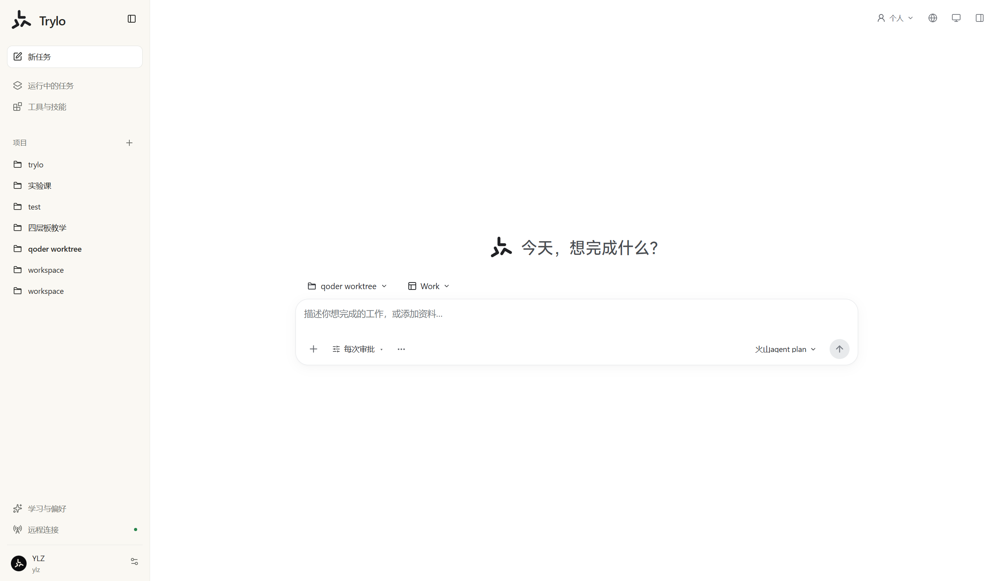
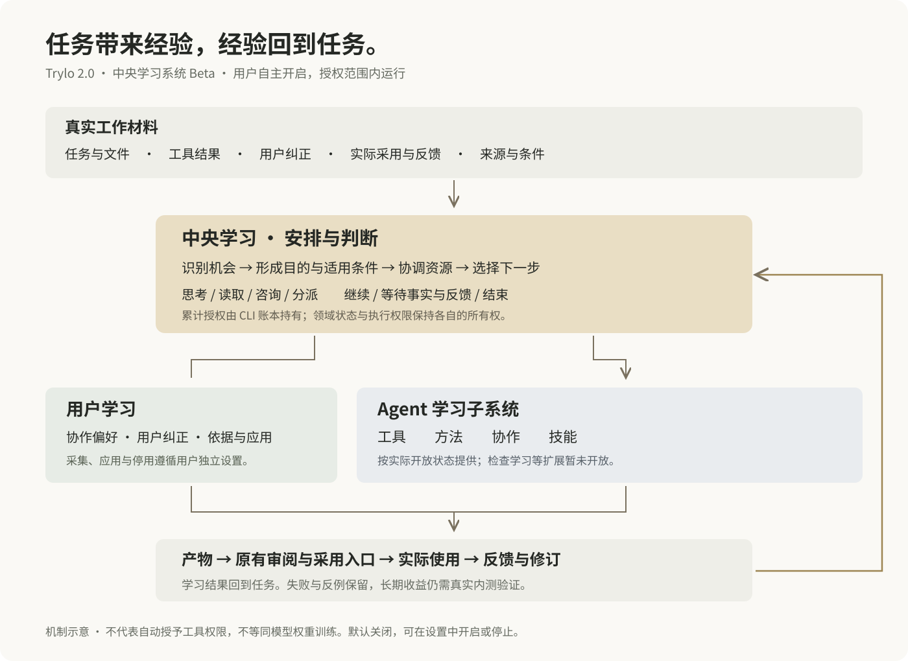
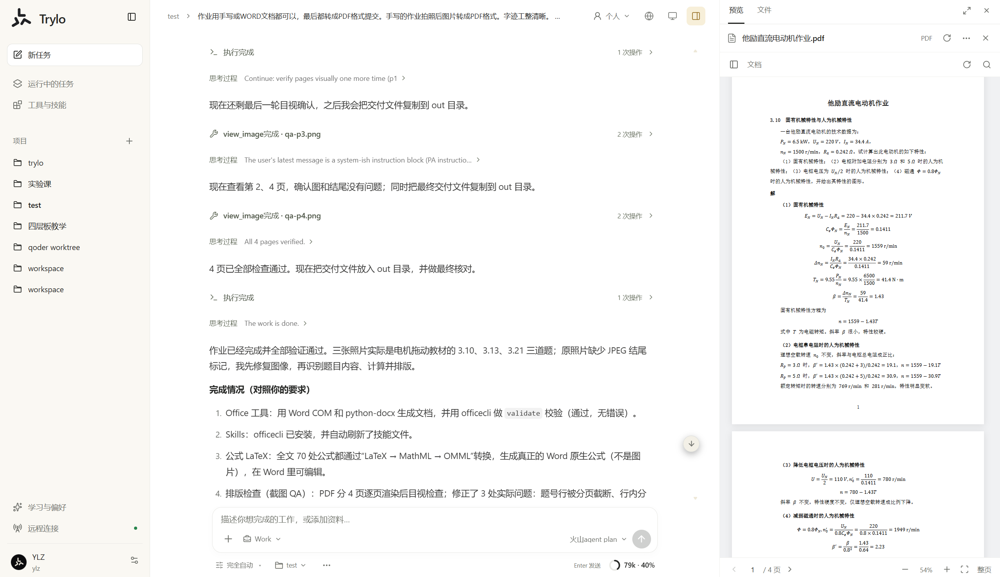
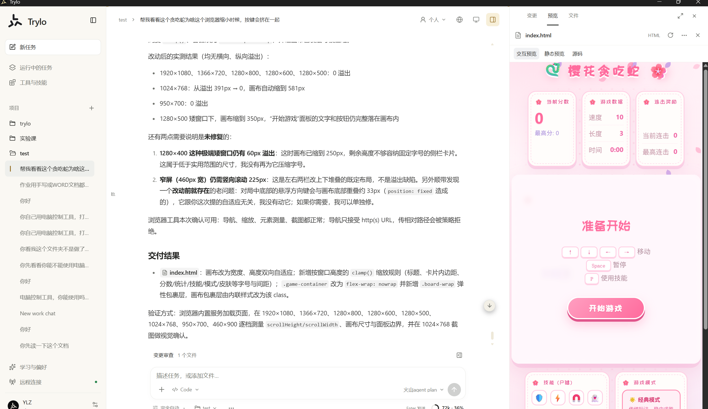
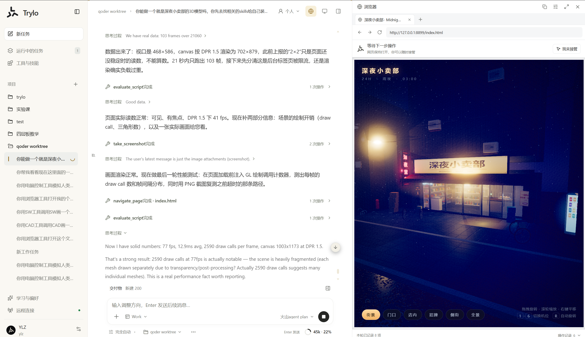
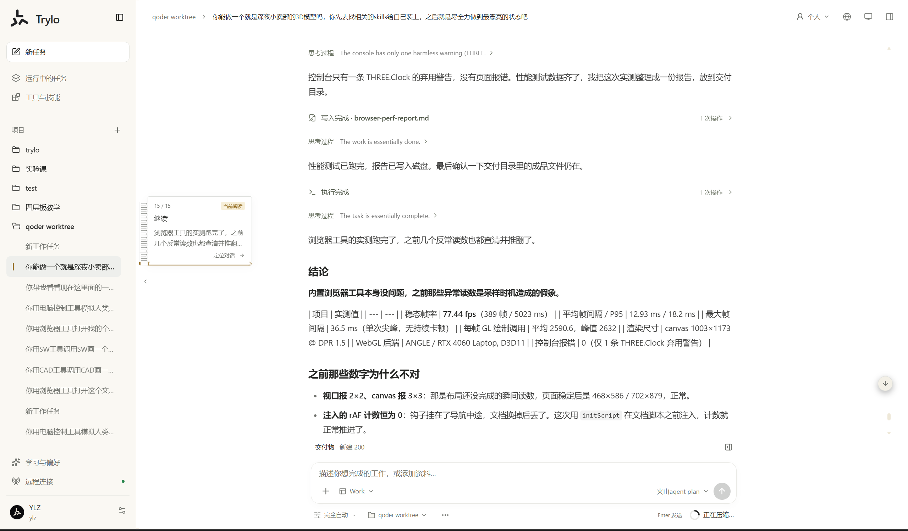

# Trylo 2.0

**Turn work into experience. Bring experience back to work.**

A personal agent for ongoing collaboration across code, documents, browsers and real deliverables.

[Download](https://trylocode.me/download/desktop/) · [Release](https://github.com/ylz92871-dotcom/trylo/releases/tag/desktop-v2.0.0) · [简体中文](README.md)

## Central learning, now in Beta

Trylo 2.0 brings a redesigned workbench, an independent next-generation CLI, improved previews and native tools, and a central learning system released as an optional experimental feature.

Central learning organizes grounded opportunities from task materials, corrections and usage feedback. It maintains a purpose and conditions, coordinates resources, and can think, read, consult, dispatch work, wait for meaningful feedback, or end an activity. User learning and the tool, method, collaboration and skill subsystems keep their own responsibilities. Results return through existing review and adoption paths; later use and feedback can inform revision.

**Experimental, off by default.** Use Settings → Learning → Central learning to opt in or out. First activation starts with the next normal task; existing workspaces can resume their saved configuration. Saving the disabled state stops the current workspace's central background learner and preserves existing experience. Independent user-learning and agent-learning settings still apply separately. Token and call authorization remain under your control; learning may continue or wait after a normal task ends.

Some controlled adoption and feedback paths have been exercised. Long-term benefit, broad generalization and sustained operation still need real-world testing. Subsystems follow their actual availability; check learning remains unavailable. This is experience and strategy learning, not automatic model-weight training or a promise that every learning attempt succeeds.

## One workbench for the whole task

View conversations beside documents, inspect interactive web outputs, and use native browser and desktop tools within the selected permissions. Context estimation, compaction, usage reporting and continuation have been improved following the project's earlier stress and long-task testing.

## Platforms

| Platform | Release |
| --- | --- |
| Windows x64 | Desktop **2.0.0**, the primary release platform. |
| macOS Apple Silicon | **First Beta**. Early platform support; expect substantial issues. |
| Linux x86_64 | **First Beta**, Debian package, built against Ubuntu 24.04 / X11. Other distributions and Wayland need further testing. Expect substantial issues. |
| Android | Existing release remains available for pairing with an online Desktop. |

[Download packages and checksums](https://github.com/ylz92871-dotcom/trylo/releases/tag/desktop-v2.0.0). macOS signing, platform permissions and compatibility are still being improved. Desktop uses only the independent new Trylo CLI; the retired engine and engine selector are removed.

## Invite-only testing

There are standard and selected-tester invitation tiers. Daily token quotas are provided during testing; flagship model-pool and related limited API benefits are for selected high-quality testers.

The upcoming program uses invitations and daily token quotas. Selected testers may receive flagship model-pool access and limited video, image and language API quotas, subject to review, availability and the current invitation terms.

The flagship pool includes **Kimi 3.1 Pro, DeepSeek V4.11017 (original provider), Qwen 3.8 Max and GLM 5.3**, alongside limited **ByteDance flagship video, image and language API** quotas.

Exact models, availability and quotas follow the invitation terms.

Email **[ylz92871@gmail.com](mailto:ylz92871@gmail.com?subject=Trylo%202.0%20testing%20application)** with your use case, operating system and feedback plan. Applications are reviewed manually; invitations and exact entitlements are sent by email.

## Source and licensing

Core source is public: `new trylo cli/`, Windows `desktop/`, local `desktop-services/`, the mobile project and the public portion of `remote-relay/`. **Website/web source stays private.** macOS/Linux adaptation repositories stay private; their Beta binaries are distributed separately. `_workspace/`, real sessions, credentials and research checkouts are excluded.

See the project [LICENSE](LICENSE) and [NOTICE](NOTICE). Third-party components retain their own licenses; required matching source and notices accompany binary releases.
