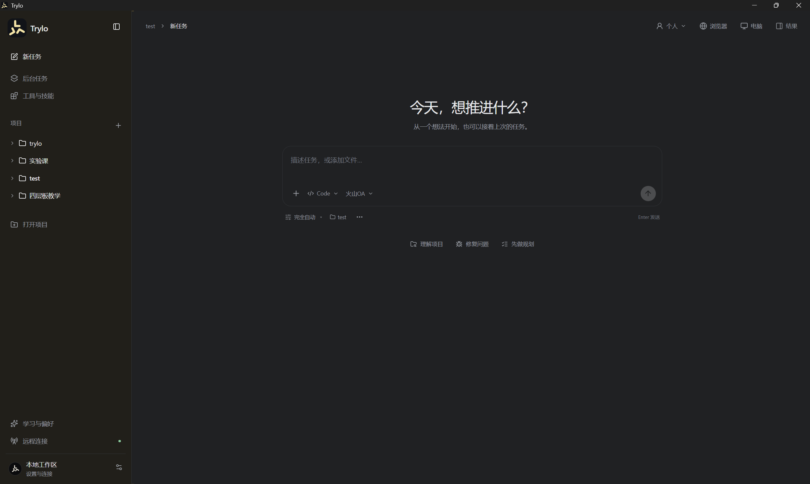
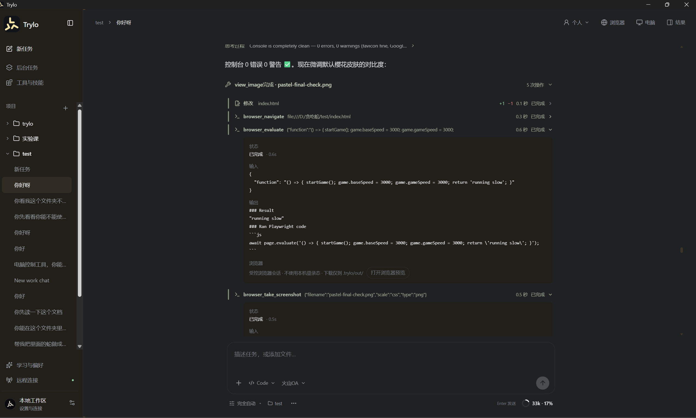
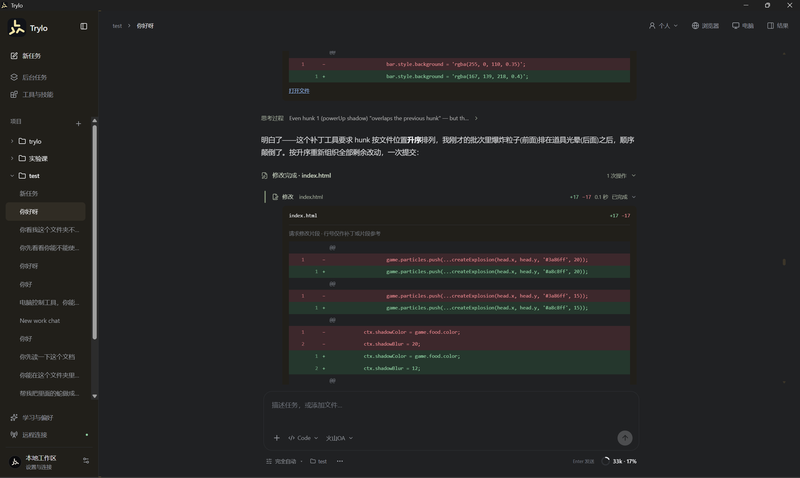
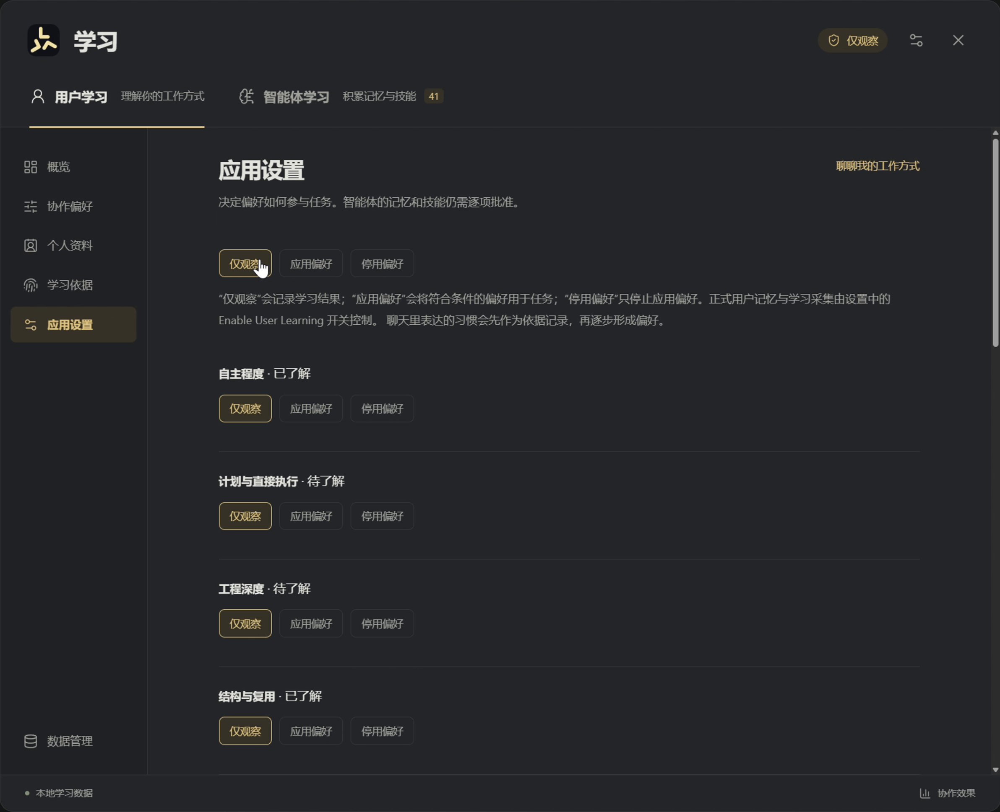
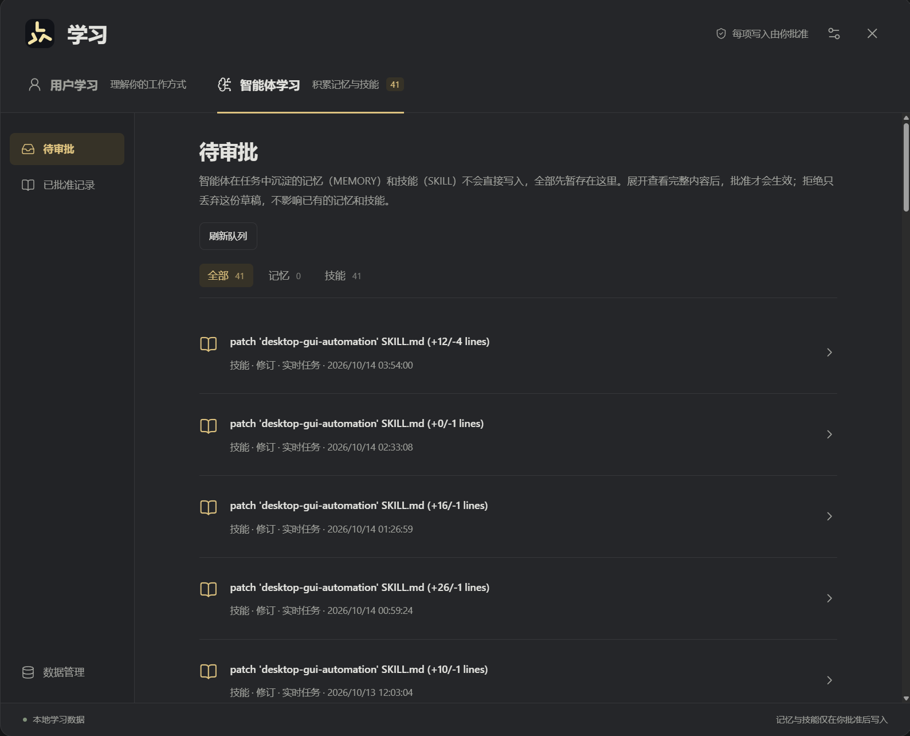

<div align="center">


# Trylo：面向长期协作的个人学习智能体

**把想法推进成成果，把协作经验留给下一次。**

从代码、文档到浏览器与桌面操作，在一个工作台里执行任务、检查结果，并逐步建立由你掌控的记忆与技能。

[简体中文](README.md) · [English](README.en.md)

[](https://github.com/ylz92871-dotcom/trylo/releases/tag/desktop-v1.0.6) [](https://github.com/ylz92871-dotcom/trylo/releases/download/desktop-v1.0.5/Trylo-Code-v1.6.0.apk) [](docs/release/CURRENT_SOURCE_CHECKPOINT.md) [](LICENSE)

**[下载桌面版](https://github.com/ylz92871-dotcom/trylo/releases/download/desktop-v1.0.6/Trylo_1.0.6_x64-setup.exe) · [下载 Android APP](https://github.com/ylz92871-dotcom/trylo/releases/download/desktop-v1.0.5/Trylo-Code-v1.6.0.apk) · [了解架构](docs/architecture/README.md)**

</div>

## Trylo宣传视频

4 分 34 秒，看看 Trylo 如何连接任务执行、电脑操作与个人学习。

https://github.com/user-attachments/assets/3dadb313-565c-49b6-8e07-6038dbb2fcfd

[下载 Trylo宣传视频 · 1080p 原片](https://github.com/ylz92871-dotcom/trylo/releases/download/desktop-v1.0.5/Trylo.mp4)

## 一个工作台，接着把事情做完

打开项目，描述目标，从当前文件和已有任务继续推进。Trylo 将对话、工具调用、文件修改与结果放在同一条工作流里，让你既能交代任务，也能随时检查进展。



| 推进任务 | 理解你的工作方式 | 积累可复用经验 |
| --- | --- | --- |
| 读写文件、运行命令，连接浏览器与电脑工具。 | 在开启用户学习后，记录协作依据，查看与纠正偏好。 | 查看记忆与技能提案，审核完整内容，再决定是否采纳。 |

## 从对话走向实际操作

写代码、整理文档、验证网页，或通过电脑工具参与桌面软件操作。Trylo 把调用的工具、输入输出与执行状态展开给你看，让任务过程有迹可循。



文件改动可以直接查看差异，再打开产物继续检查。从“准备做什么”到“实际改了什么”，都能回到具体内容。



## 长期协作，从可控的学习开始

每个人对计划、解释、检查和交付的要求都不同。Trylo 将**用户学习**与**智能体学习**分别呈现：前者关注你的协作方式，后者管理任务中沉淀的记忆与技能。

### 偏好如何参与任务，由你决定

用户学习需要显式开启。你可以查看学习依据、纠正偏好，并选择仅观察、应用偏好或停用偏好。记录下来的内容是否适合继续使用，可以由你持续判断。



### 经验沉淀之前，先让你过目

智能体学习产生的记忆与技能提案进入待审批队列；展开完整内容、检查修改，再决定批准或拒绝。学习结果与执行权限分别管理，批准学习内容不会自动授予工具权限。



## 桌面、终端与手机，连接同一份工作

| 入口 | 可以做什么 |
| --- | --- |
| **Desktop** | 原生桌面工作台，集中查看项目、任务、工具、学习与结果。 |
| **Trylo CLI / TUI** | 在终端使用执行循环、工具、会话恢复与学习能力；新版 TypeScript 源码随库公开。 |
| **Android APP** | 配对桌面端，作为远程工作台查看与接续任务；需要桌面服务及可达网络。 |
| **工具与服务** | 文件、命令、浏览器和 Windows 电脑工具由本地服务连接；能力取决于已安装组件、模型与权限配置。 |

CoWork 后台保持独立，作为可选依赖，不随核心桌面包捆绑。

## 开始使用

1. 从 [GitHub Releases](https://github.com/ylz92871-dotcom/trylo/releases/tag/desktop-v1.0.6) 下载 Windows 安装版或便携版。
2. 打开工作区，在设置中配置模型服务与凭据，按任务需要选择工具和权限。
3. 创建一个任务，从读懂项目、修复代码或整理资料开始；需要长期学习时，再显式开启对应选项。
4. 需要手机接续时，安装 Android APP，按桌面端远程连接界面的指引完成配对。

| 下载 | 版本与说明 |
| --- | --- |
| [Windows x64 安装版](https://github.com/ylz92871-dotcom/trylo/releases/download/desktop-v1.0.6/Trylo_1.0.6_x64-setup.exe) | Desktop 1.0.6 |
| [Windows x64 便携版](https://github.com/ylz92871-dotcom/trylo/releases/download/desktop-v1.0.6/Trylo-Desktop-1.0.6-windows-x64-portable-core.zip) | 核心桌面包，CoWork 独立 |
| [Android APK](https://github.com/ylz92871-dotcom/trylo/releases/download/desktop-v1.0.5/Trylo-Code-v1.6.0.apk) | Android 1.6.0；沿用已签名构建 |
| [SHA-256 校验值](https://github.com/ylz92871-dotcom/trylo/releases/download/desktop-v1.0.6/SHA256SUMS) | 下载后可核对文件完整性 |

**当前为 Alpha。** Desktop 1.0.6 仅包含并默认使用新版 Trylo CLI，旧 CLI 与 CoWork 后台不随包分发，旧版选择会迁移为新版。本次已重新编译 10 月 24 日同步的产品源码。验证范围见[当前检查点](docs/release/CURRENT_SOURCE_CHECKPOINT.md)和[发布记录](docs/release/DESKTOP_1_0_6.md)；界面截图与演示不代表所有模型、软件与设备组合均已验证。

## 为开发者准备的入口

Trylo 将界面、执行内核、本地工具服务和学习机制分开组织，便于理解职责与追踪任务链路。

| 目录 | 职责 |
| --- | --- |
| [`desktop/`](desktop/) | React + Tauri 原生桌面 |
| [`new trylo cli/`](new%20trylo%20cli/) | TypeScript CLI/TUI、执行、协议、权限、上下文与学习 |
| [`desktop-services/`](desktop-services/) | 本地 Service Host、工具、浏览器与远程服务 |
| [`new_tool/`](new_tool/README.md) | Windows-MCP fork、来源记录与依赖安装 |
| [`work/`](work/) | 工作流、运行适配与交付物 |
| [`mobile-app/`](mobile-app/) | Android 远程工作台 |
| [`trylocode-site/`](trylocode-site/) | 网站源码 |

[架构说明](docs/architecture/README.md) · [源码构建](docs/development/build-from-source.md) · [目录与迁移](docs/development/repository-layout.md) · [近期 CLI 排障与验证](docs/release/NEW_CLI_DEBUG_2026_10_22.md)

Windows x64 / Node.js ≥ 22 的新版 CLI 构建：

```powershell
# 仓库根目录：显式准备固定版本的原生依赖
node scripts/setup-cli-native.mjs --install
cd "new trylo cli"
npm ci
npm run build
```

完整 Desktop 发行构建还需要对应的运行时及制品清单，具体前置条件见[构建说明](docs/development/build-from-source.md)。源码检查、真实模型验证、原生桌面与安装包验收在文档中分别记录。

## 开源与致谢

项目自产代码采用 [Apache-2.0](LICENSE)，第三方组件保留各自许可证与来源说明，详见 [NOTICE](NOTICE)。公开源码不包含旧 CLI 源码、凭据和本机构建缓存。欢迎通过 [Issues](https://github.com/ylz92871-dotcom/trylo/issues) 反馈可复现的问题，通过 Pull Request 参与改进。
