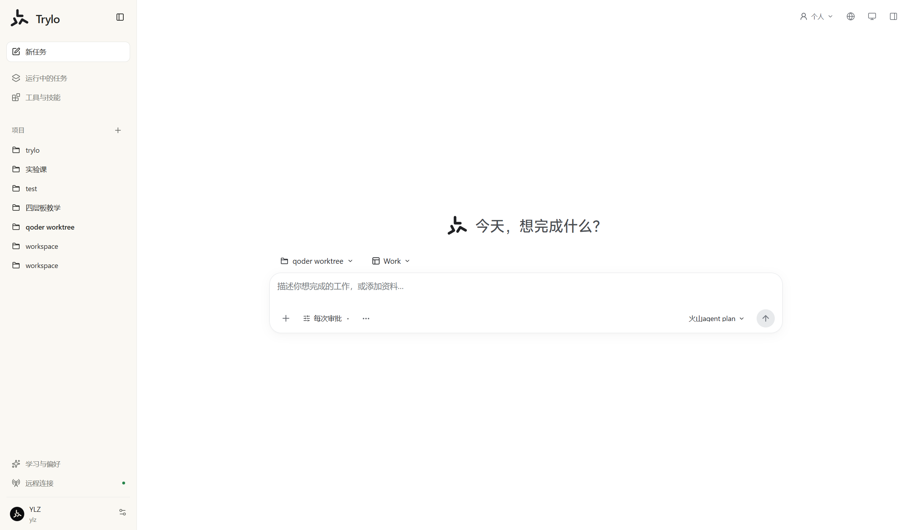
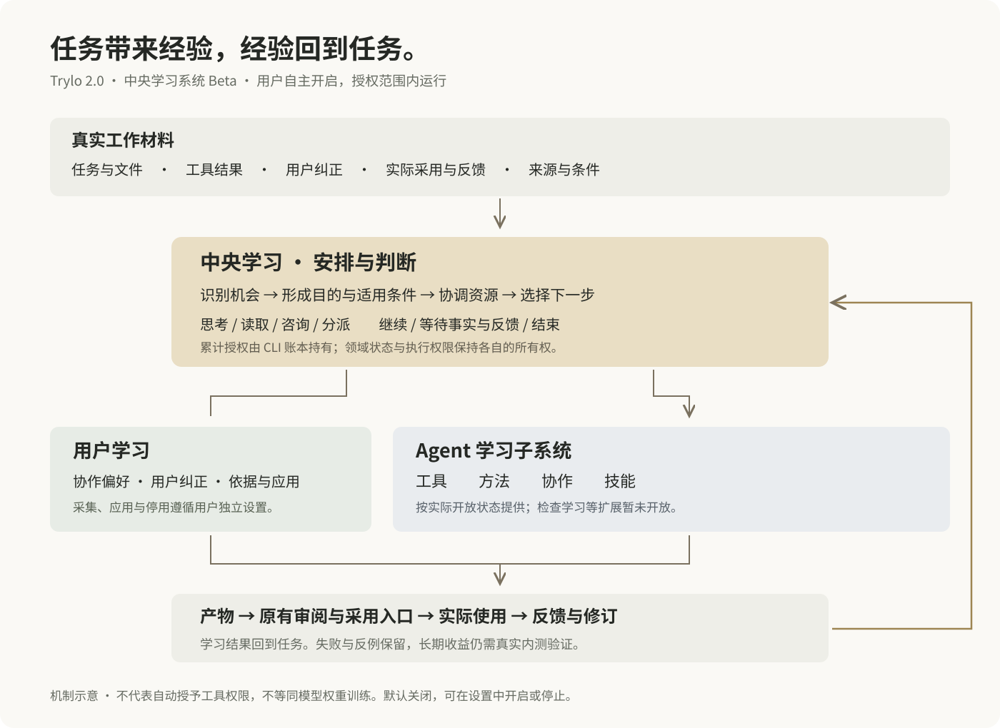
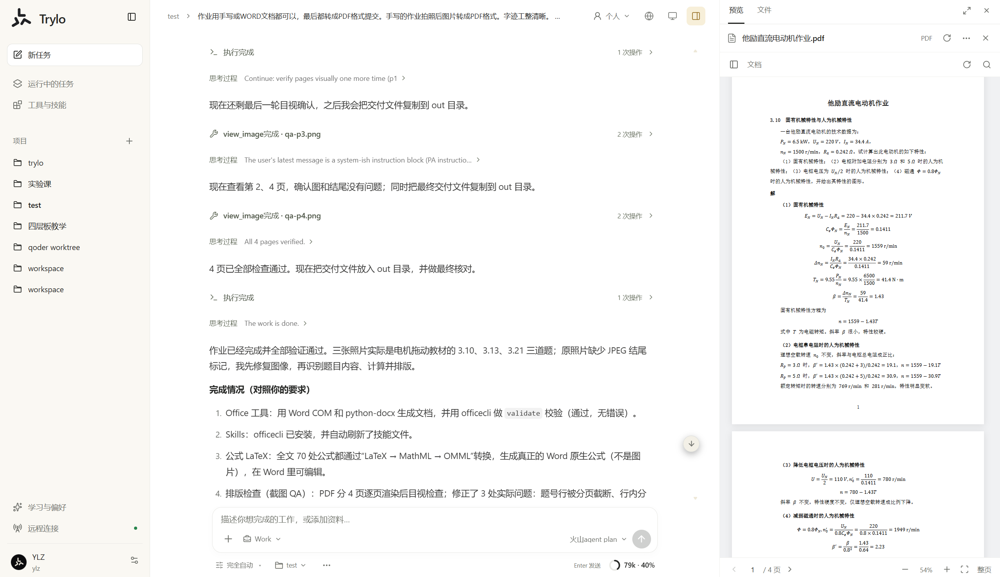
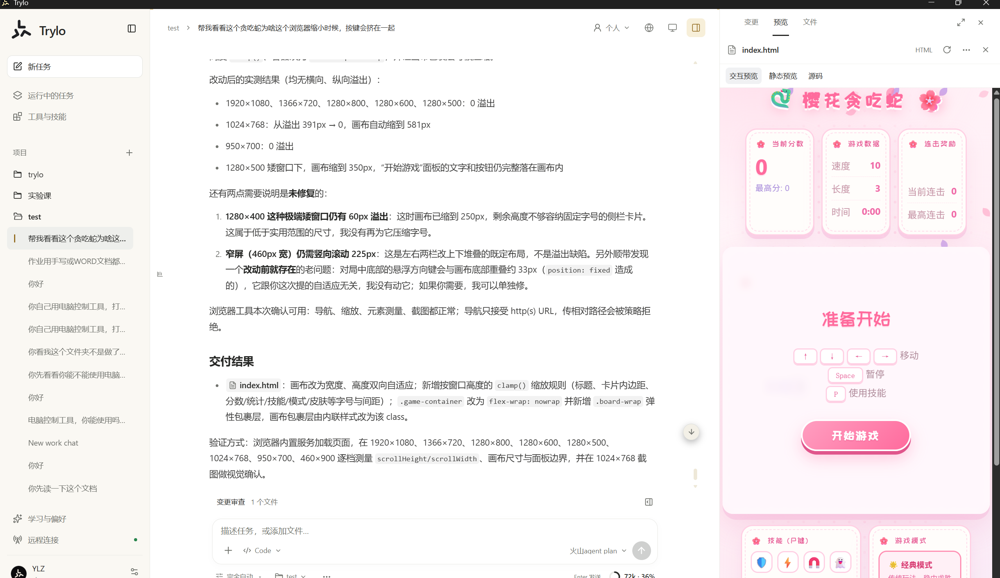
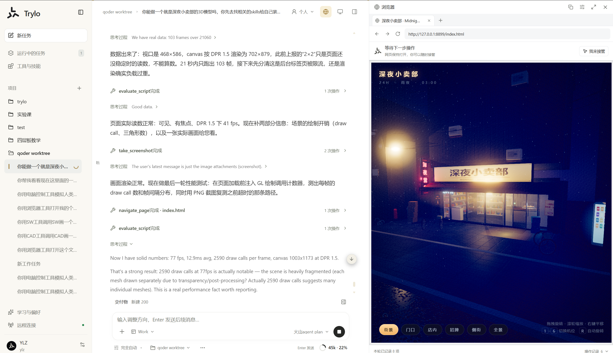
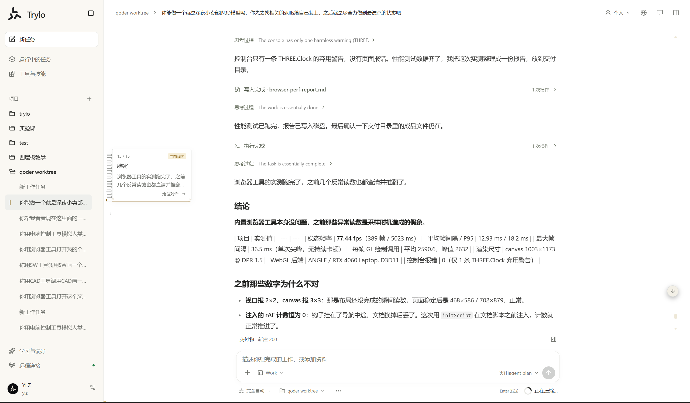

# Trylo 2.0

**任务带来经验，经验回到任务。**

一个会与你持续协作的个人智能体。代码、文档、浏览器与实际成果，在同一个工作台里展开。

中央学习系统 Beta · 全新 Desktop · 独立的新一代 Trylo CLI

[官网下载](https://trylocode.me/download/desktop/) · [GitHub Releases](https://github.com/ylz92871-dotcom/trylo/releases/tag/desktop-v2.0.0) · [更新说明](docs/release/DESKTOP_2_0_0.md) · [English](README.en.md)

## 这一次，把学习放在中央

Trylo 2.0 是一次大版本更新。全新工作台、预览体验、上下文处理与原生工具一同进化；**中央学习系统以测试功能首次作为本次发布的核心能力开放**。

我们希望一个长期陪你工作的智能体，能把一次任务里的经验变成下一次任务可参考的做法：哪些步骤有用，工具哪里需要改进，你怎样判断一份合格的交付，以及原先的方法什么时候应该修订。

中央学习围绕这些问题组织工作。它读取有出处的任务材料、用户纠正和使用反馈，形成带目的与条件的学习安排，协调相应子系统，再把产物交还原来的任务与学习入口。后续采用与反馈继续参与修订。

| 层次 | 负责的事情 |
| --- | --- |
| **中央学习** | 识别学习机会，维护目的与条件，决定继续、等待、咨询或分派；在用户授权资源内协调学习。 |
| **用户学习** | 理解协作偏好与纠正；保留依据，由用户决定采集、应用与停用。 |
| **工具学习** | 从工具使用与失败中整理改进机会，连接生产、审阅与使用反馈。 |
| **方法学习** | 整理可复用步骤、适用条件与反例，让后续任务参考并修订做法。 |
| **协作学习** | 关注角色分工、交接与共同推进任务的经验。 |
| **技能学习** | 连接技能发现、采用和反馈，管理可复用能力。 |
| **共同边界** | 原始执行、工具权限、学习产物审阅各有其权威；中央学习不会自动扩大操作权限。 |

**这是 Beta / 测试功能。** 在 **设置 → 学习 → 中央学习系统** 自主开启或关闭，默认关闭。开启后首次启动随下一次正常任务进行；已有工作区可恢复保存的学习配置。关闭并保存会停止当前工作区的中央学习后台，已有经验保留。累计 token 与调用授权由你设置，后台可能在业务任务结束后继续或等待。独立的用户学习与其他学习选项仍按各自设置生效。

当前已打通部分受控的学习、采用与反馈路径；持续运行、跨领域泛化与长期收益仍需要内测验证。各子系统按实际开放状态提供，检查学习仍暂未开放。本版本不会将学习记录数量当成学习效果，也不承诺每次学习都有效。这是一套工作经验与策略的学习系统，不涉及自动训练模型权重。

[深入了解学习机制与边界](docs/architecture/CENTRAL_LEARNING_2_0.md)

## 从想法到成果，工作过程完整展开

### 在文档里看见交付

对话、工具结果与文档预览并排呈现。写完之后，继续打开、检查和修改成果，让任务有清晰的落点。

### 在预览里继续创作

网页可以交互，代码与成果可以来回查看。本次完善了多类文件预览、资源加载与展示体验，减少在不同应用之间切换的打断。

### 工具就在工作现场

内置浏览器、文件、命令与桌面工具连接实际工作。原生工具体验与错误反馈进一步优化；能否执行仍由平台能力、模型配置和用户授权决定。

### 长任务，有可以接着走的上下文

新 CLI 改进了上下文估算、压缩、使用量呈现与任务续接，修复了多项已知执行问题。此次更新建立在此前多轮压力与长任务测试工作的基础上；模型和任务差异仍会影响实际表现。

## 选择你的平台

| 平台 | 本次发布 |
| --- | --- |
| **Windows x64** | Desktop **2.0.0**，本次主要发布平台。 |
| **macOS Apple Silicon** | **首版 Beta**。目前仅提供 Apple Silicon 构建，平台适配仍早期，预计存在较多问题。 |
| **Linux x86_64** | **首版 Beta**，Debian 包；以 Ubuntu 24.04 / X11 构建环境为基线，其他发行版及 Wayland 体验尚待验证，预计存在较多问题。 |
| **Android** | 继续使用现有版本，与在线的 Desktop 配对接续任务。 |

**[前往官网下载](https://trylocode.me/download/desktop/)** · [发布资产与 SHA-256](https://github.com/ylz92871-dotcom/trylo/releases/tag/desktop-v2.0.0)

Desktop 2.0 仅使用独立研发的新版 Trylo CLI，旧 CLI 已退役，不再提供引擎切换。Windows 安装前请退出 Trylo；首次 macOS/Linux Beta 的签名、系统兼容性与权限体验仍有待完善。

## 即将进入邀请码内测

邀请码分为标准内测与优质内测两类。测试阶段提供每日 token 配额，旗舰模型池及相关限量 API 权益面向优质内测用户开放。

我们正在邀请愿意认真使用、记录问题和提供反馈的内测伙伴，一起打磨下一代个人智能体。

内测旗舰模型池：**Kimi 3.1 Pro、DeepSeek V4.11017（原厂版）、Qwen 3.8 Max、GLM 5.3** 等。另提供 **字节旗舰视频、生图与语言模型 API** 的限量体验配额。

具体模型、额度与开放时间以邀请通知及当期供应为准。

请发送邮件至 **[ylz92871@gmail.com](mailto:ylz92871@gmail.com?subject=Trylo%202.0%20内测申请)**，介绍使用场景、操作系统与可以提供的反馈。作者人工审核后通过邮件发放邀请码。

[了解内测计划](https://trylocode.me/#beta)

## 开发者入口与公开范围

本仓库公开核心源码。**官网和网页端源码为内部代码，不开源**；macOS/Linux 平台适配仓库也保持私有，仅开放 Beta 二进制。开发过程、真实会话、凭据、研究副本与 `_workspace/` 不在公开范围内。

| 目录 | 内容 |
| --- | --- |
| `new trylo cli/` | 独立的新一代 CLI / TUI、执行、上下文、工具与学习系统。 |
| `desktop/` | Windows Desktop 工作台、预览与原生宿主。 |
| `desktop-services/` | 本地服务、工具桥接与工具链来源说明。 |
| `mobile-app/` | 手机端工程。 |
| `remote-relay/` | 远程连接与配套服务的公开源码部分。 |
| `docs/` | 架构、使用说明与发布记录。 |

构建入口见 [Desktop](desktop/README.md)、[CLI](new%20trylo%20cli/README.md) 与各工程依赖清单。第三方工具、字体、编解码器与其他分发组件遵循各自许可证；发布二进制的对应来源及许可材料随发布资产提供。

项目许可证见 [LICENSE](LICENSE)，第三方声明见 [NOTICE](NOTICE)。
