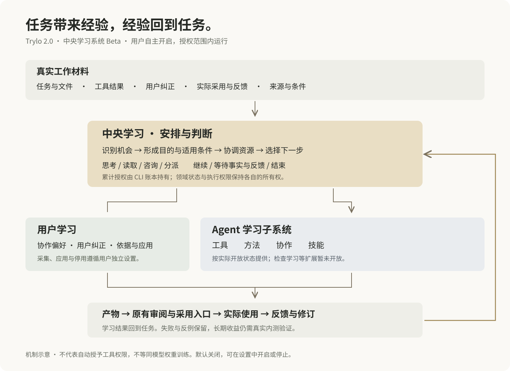

# 中央学习系统 2.0 Beta

## 从材料到采用反馈

1. 正常任务、工具结果、用户纠正和使用反馈提供有来源的材料。
2. 中央维护学习目的、适用条件、已有知识、未解问题与继续条件，判断下一步操作。
3. 操作可为思考、读取、咨询或分派。等待可针对事实、使用反馈、资源或明确时间。
4. 用户学习与 Agent 领域模块保留自己的状态所有权与产物流程；中央协调不会成为另一份工具权限。
5. 采用记录、原生工作结果和反馈回到原目的，帮助保留、修订或结束安排。结束支出和回答原问题是分别记录的事实。

当前实现入口位于 `new trylo cli/src/internal/learning/central/`、`control/` 与 `agent/subsystems/`。`runtime/contracts.ts` 定义材料、学习意图、操作、等待和返回结果等结构。Desktop 使用共享设置页与 CLI 工作区后台控制接口，Code 和 Work 读取同一份设置。

## 授权与状态

默认关闭；设置中的“中央学习系统 · 测试功能”提供显式选择。配置首次启用的累计 token、调用授权，以及单次思考包络。共享预算由原 CLI 账本持有，任务结束不重置授权。已有工作区的授权在学习管理入口调整。

保存关闭会请求停止当前工作区中央后台；已有学习材料保留。用户学习、独立 Agent 学习的其他选项遵守各自配置。中央开启不意味着任何学习产物自动获批，也不意味着扩大工具执行范围。

## 当前边界

本图是机制总览，不代表所有子系统都已开放或长期有效。工具、方法、协作和技能等领域按当前实现提供；检查学习暂未开放。部分受控学习已有采用与反馈，长期收益与跨域泛化仍在测试。该机制管理经验、技能与策略，不自动训练模型权重。
