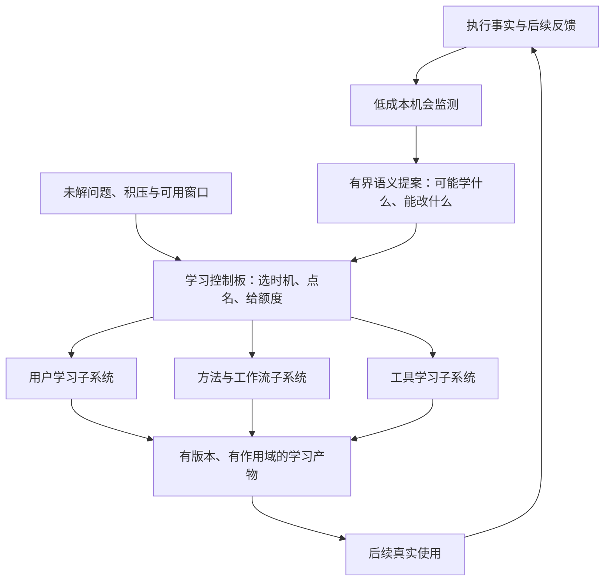

# 人脑如何调节学习时机：对 Trylo 学习控制板的设计启发

> 状态：调研报告 / 设计讨论稿，不是已批准施工合同。  
> 日期：2026-10-28（Asia/Shanghai）。  
> 问题：什么经历值得学、什么时候处理、投入多深，以及如何让学习减少未来的重复劳动。  
> 输入：用户本轮《我的 Agent Learning 设计理念与核心思路》、Trylo 学习顶层架构和学习意志、20 篇定向研究。  
> 阅读范围：关键神经科学正文段落、计算模型论证与实验摘要；Agent 论文的原始摘要和相关机制。没有声称逐篇全文精读或复现论文。文末逐项标注阅读依据。

## 一、先给结论

对 Trylo 最有价值的借鉴，是把学习调度看成一个持续的资源分配问题：**这段经历还包含什么能改善未来行为的信息；现在处理它，比继续执行或处理别的经历更值得吗？**

本轮建议重点吸收三组思想：

1. **环境变化与随机噪声分开。** 同样是意外，可能应该更快更新理解，也可能应该少受这一条样本影响。[N02–N05]
2. **按未来用途和行为增益选择经历。** 优先处理“很快还会遇到，并且确实可能改变做法”的经验，不只按失败严重度排序。这主要是规范性模型提供的设计思想，不是已经找到大脑统一算法。[N08]
3. **按计算的预期价值决定投入强度。** 额外分析、验证和整理都有成本，控制系统要学会何时投入、何时停止。[N11、N12]

因此，推荐讨论一种分层控制板：**低成本持续感知 → 对值得处理的片段形成语义学习提案 → 按未来收益和预算分配处理深度 → 子系统执行 → 根据后续真实使用修正调度判断。** 这是工程候选，不是脑区到代码的直接翻译。

## 二、先把“人脑决定什么时候学”拆清楚

### 2.1 并不存在一个已被确认、统一管理所有学习的大脑开关

相关研究分别涉及预测误差、注意和唤醒、学习率、记忆编码、回放、巩固、认知控制。它们处于不同层次。多巴胺系统、海马及皮层网络、前额叶和扣带相关控制过程各提供部分机制；没有一篇本文引用的论文证明它们等价于一个中央调度板。[N01、N03、N06、N09、N11]

Trylo 可以为了工程可维护性设置统一控制板，但这是软件的状态与资源所有权选择，不需要先证明脑内有一个同名机构。

### 2.2 至少要分清五种“什么时候”

| 问题 | 在认知研究中对应什么 | 对 Agent 的讨论性映射 |
| --- | --- | --- |
| 当下哪些信息值得注意 | 意外、目标相关性、好奇与注意 | 哪个经历片段先获得处理资格 |
| 这一条反馈要改多少已有判断 | 学习率与不确定性调节 | 对旧理解更新多大，而非直接分多少 token |
| 哪些经历值得再处理 | 记忆提取与优先回放 | 选择待处理的经历、证据或未解问题 |
| 什么时候更适合再处理 | 决策前、短暂停顿、休息和睡眠中的不同过程 | 立即处理、边界后处理、延后处理 |
| 什么值得长期留下 | 选择性巩固及后续效果 | 保留、限定、修订和复用资产 |

这些映射由下文研究共同启发，不是五个已被定位的一一对应脑模块。

尤其要区分：**观察到一条信息、花钱分析它、修改当前策略、形成长期经验，是四件不同的事。** 可以先留下获准采集的事实引用，等结果出现后再决定是否深入；也可以立即修正当前任务，而暂不形成跨任务经验。

### 2.3 生物类比应该借鉴机制，不宜逐字照搬

人的学习可能涉及突触与网络可塑性；“人不会每件事都重新训练整个大脑”不能被用来证明生物学习不改任何参数。对 Trylo 更可靠的借鉴是选择性、多时间尺度、情境依赖和资源限制。API 模型保持不变、通过外部经验改变系统行为，是可独立检验的工程路线；其可行性不依赖生物学上的字面同构。[A01、A04、A05]

## 三、相关研究真正告诉了我们什么

### 3.1 反馈的重要性不只是奖惩大小，还包括“与预期差多少”

Schultz、Dayan 与 Montague 的经典工作把灵长类多巴胺反应与奖励预测误差联系起来：意外结果与已经预期的结果，产生的信号并不相同。[N01]

**设计启发：** 如果一次成功完全符合已知方法，额外提炼的边际价值可能很低；如果一条替代路径意外成功，可能值得记录其适用条件。失败和成功都能提供学习机会。

**边界：** 多巴胺不是所有学习的统一“快乐分数”。奖励预测误差也不能直接翻译为“失败越大，反思 token 越多”。这是从生物信号到软件预算之间需要另外解决的问题。

### 3.2 最重要的区别：世界变了，还是世界本来就有噪声

Behrens 等研究人如何根据环境波动调整学习；Nassar 等进一步把变点概率、相对不确定性与动态学习率联系起来，发现瞳孔相关唤醒指标与这些过程有关。[N02、N03]

Piray 与 Daw 在同一任务中研究波动性和随机性。结果支持：潜在规律变化与观测噪声增加，对学习率具有相反影响。[N04]

Pulcu 与 Browning 的后续研究也提醒我们，人会错误地把噪声当成环境变化，因而过度更新。人类并非天然最优的调度标杆。[N05]

| Agent 经历 | 更值得先考虑的解释 | 合理候选动作 |
| --- | --- | --- |
| 同一 API 偶发超时，随后正常 | 随机性、瞬态外因 | 记录可靠性；不立即改通用方法 |
| API 升级后连续返回新格式 | 环境/工具版本变化 | 核对新合同，标记旧经验可能失效 |
| 对任务背景了解不足 | 可减少的知识不确定性 | 定向取证或查询 |
| 实验中重复无效尝试，却出现不了新信息 | 当前分析路径收益低 | 暂停、等待新证据或改取证方式 |

表中动作是工程推断。真实系统还可能同时存在多种原因，不能仅凭错误码就认定是哪一种。

### 3.3 没有失败时，也可能值得学

Gruber 等在人类好奇任务中发现，高好奇状态与更好的后续记忆表现相关，并研究了海马与中脑奖赏相关区域的活动。[N06]

**设计启发：** 控制板除了失败，还应该能接收“重要但未解的缺口”“有前景的替代方法”“近期任务会需要的知识”等学习机会。好奇不是随便逛：对 Agent 应转化为目标相关、可说明预期用途的探索提案。

该研究不能证明为 Agent 增加一个好奇心评分器必然有效，也不能支持无限主动探索。

### 3.4 重要性可以晚于经历本身出现

Dunsmoor 等在人类实验中发现，后来的情绪学习可选择性增强此前与其概念相关的记忆；效应与延迟巩固有关。[N07]

**设计启发：** 不要强迫控制板在经历发生当刻就决定全部价值。可以先留一条有身份、可追溯、符合采集许可的经历索引；后续结果到来后，重新提高相关片段的处理优先级。

这支持“迟到结果可能改变处理价值”的类比；不证明某个具体谈判行为就是损失原因，也不支持越强烈的反馈就越广泛地永久记忆。

### 3.5 回放哪段经历，可以按 Need × Gain 理解

Mattar 与 Daw 提出优先记忆访问的规范性模型：一次回放的价值取决于它能带来的行为改善，以及相关状态未来会被访问的程度，常概括为 **Gain × Need**。[N08]

对 Trylo 可理解为：

- **Gain：** 如果处理这段经历，未来到底可能换掉哪种行为，收益在哪里？
- **Need：** 这样的场景以后多大可能再遇到，是否很快就要用？

“反思出一段很深刻的话”不等于高 Gain；如果没有可改变的决策，它可能没有实际收益。罕见的一次性场景也未必值得投入大量泛化成本。

**关键限制：** 原论文明确区分“理想情况下应优先访问什么”和“怎样高效找到它”。它没有给开放环境中的 Trylo 提供现成、可直接算准的收益函数。

### 3.6 学习可以发生在短暂停顿，不必等到整项任务结束

Buch 等用人类 MEG 研究技能学习，发现练习间短暂休息时存在快速的海马—皮层回放，其程度与技能巩固相关。[N09]

Rudoy 等则通过睡眠中的定向声音线索，选择性影响特定物体位置记忆的巩固。[N10]

**设计启发：** 执行边界和空闲窗口值得纳入调度；延后处理也可以只针对少量相关片段。这里没有推出“睡眠等于全库自动扫描”，更没有推出 Agent 应在夜间无限反思。生物实验的秒数、睡眠阶段不能直接成为软件定时器参数。

### 3.7 “值得多想吗”本身也是可以学习的判断

Shenhav、Botvinick 与 Cohen 的 Expected Value of Control 理论，把控制分配描述为收益、投入强度和努力成本的权衡。[N11]

Lieder 等的 Learned Value of Control 模型进一步讨论如何从经验学习不同控制方式及强度的价值，并解释若干注意与干扰控制实验。[N12]

**设计启发：** 控制板长期可以积累“这类机会做一次分析是否通常有用、哪种子系统更合算”的经验。开始阶段无需训练底层大模型，可以先保留调度选择、实际费用和后续使用结果，逐步改进小规模价值估计。

两篇工作主要提供计算层解释；不能据此断言某个脑区已经实现了可抄写的最优预算算法。

## 四、Agent 论文中可以拿来组合的机制

以下研究提供的是不同局部零件。它们并未共同验收一个开放环境、跨子系统、长期自适应的学习控制板。

| 论文 | 与本题最相关的机制 | 可借鉴内容 | 不应直接推导的结论 |
| --- | --- | --- | --- |
| Reflexion，2023 [A01] | 反馈转为文字经验，影响后续尝试 | 同任务反馈到后续行为的连接 | 自动解决何时学、跨任务归因和预算分配 |
| Self-Refine，2023 [A02] | 输出—自反馈—修订 | 一种局部、有边界的改进操作 | 每次都循环会更省、更正确 |
| Huang 等，ICLR 2024 [A03] | 无外部反馈的内在自纠错可能失效或降质 | 保留环境结果和外部事实的重要性 | 所有自反馈都无效，或所有当前模型都不能自纠错 |
| ExpeL，AAAI 2024 [A04] | 从经历提炼可复用的自然语言知识 | 多经历形成方法，而非只存轨迹 | 提炼本身足以证明净收益 |
| Agent Workflow Memory，2024 [A05] | 诱导、复用工作流，覆盖在线/离线情形 | 把常见行动组织成可调用套路 | 工作流归纳时机已实现最优调度 |
| Scaling Test-time Compute for LLM Agents，2025 [A06] | 比较多种增加计算的策略，强调反思时机 | 把反思视为需要分配的计算操作 | 增加计算总会提高长期学习收益 |
| ReasoningBank，所读 v2 为 2026 [A07] | 成功/失败经历中的推理记忆及经验扩展 | 正负经历、后续任务消费、计算与记忆的联系 | 自判成功等于真实成功，或论文代码已在 Trylo 可用 |
| ACE，所读 v3 为 2026 [A08] | 结构化、增量更新上下文经验 | 避免每次整库重写导致信息流失 | 要持续改底层 system prompt，或全库自动反思已获授权 |

这里更值得吸收的是：**把可复用经验做成持续可修改、可调用的资产；把“再分析一轮”看成可选操作。** 不需要为了学习而改内核，也不需要在每次经历后执行同一条昂贵 workflow。

本轮没有复制或运行这些项目的代码，没有完成依赖、许可证闭包或生产可达性审计。论文机制参考与第三方基础设施准入是两件事。

## 五、对你提出的“底层奖惩机制”的建议

### 5.1 相对稳定的应是目标、事实来源和边界

可以相对稳定地规定：改善长期任务表现，减少用户重复解释与无效劳动，控制学习总成本；权限不因学习扩大；推断不能变成用户明令；沉默不是肯定。

但“怎样解释一次反馈、是否值得继续处理、未来还能不能复用”需要随证据变化。**稳定提示词可以表达这些原则，不能单靠一段提示词完成可靠的奖励测量、因果归因和预算管理。** 后几项需要真实事件、状态、费用和后续结果。

### 5.2 先保留不同维度，再决定如何调度

建议不要立即把所有信息压成一个奖惩总分。一次反馈至少应能区分下列问题；它们是讨论问题，不是本报告冻结的新 schema：

| 维度 | 需要回答什么 |
| --- | --- |
| 结果 | 真的发生了什么？成功、失败、取消、未知分别是什么？ |
| 意外 | 与事前预期相比，哪里不一样？没有事前预期时不能伪造精确预测误差 |
| 证据可信度 | 环境观察、明确用户反馈、工具输出、模型自报分别支持什么 |
| 可改变性 | Agent 的哪个决策可能影响结果？是否存在可替代行动？ |
| 不确定性来源 | 缺知识、外部噪声、规律变化，还是目前分不清？ |
| 未来用途 | 何种情境会再次用到；改善哪个决策？ |
| 处理成本 | 需要多少增量 token、时间、执行资源和用户打扰？ |

高损失但原因未明的经历，可以获得较高的**调查优先级**，同时保持较低的**长期结论确信度**。学习投入与写入长期结论的强度应分开，不能一起随损失放大。

不可控外因也并非完全无可学内容：未必应该惩罚原方法，但可能值得学会更早识别外因、明确能力边界或采用备用路径。这属于对未来行动空间的重新检查。

### 5.3 模型自报与任务效果各保留其身份

沿用已有所有者意志，`helped` bool 可以继续作为“模型认为经验是否帮上忙”的使用信号。它与任务结果、用户明确评价并存，不互相冒充。

这里不建议恢复已经被否定的独立“法官体系”，也不把任务完成自动当经验有用。判断实际收益尽量利用本来就发生的工具结果、任务产物、后续返工和明确反馈；没有足够证据时，允许保持未知。

## 六、推荐讨论的控制板实现方向

### 6.1 采用分层，不让顶板成为第二个干活的 Agent



图中语义提案是功能，不要求增加一个独立常驻模型。它可由执行模型在获准时共枪提出，也可由相应子系统对少量经历作有界分析。顶板消费提案和事实，决定先处理谁、何时处理、给多少。

这样既保留开放语义，又避免把“路径报错”硬编码成“只能学路径规范”。新任务可以提出未见过的课题；预算、幂等、超时和权限仍由确定性的工程合同守住。

### 6.2 连续监测应当便宜，昂贵语义分析按机会发生

低成本层可以处理身份关联、重复机会、工具版本变化、费用累计、等待中的结果、已分析证据去重、队列年龄和取消。它提供机会，不定义经验内容。

语义层则回答：

> 这次与预期哪里不同？值得改变的决策是什么？它属于当前任务、用户合作方式、可复用方法还是工具能力？已有经验够不够？还缺什么证据？

优先复用已有执行枪里的信息与有界摘要。不能为了判断是否省 token，先把所有历史扫描一遍；同一组证据没有新结果时，也不应反复付费分析。

### 6.3 用“未来行为增益减处理成本”组织决策，不先迷信打分公式

可用下面的工程目标表达方向：

```text
处理价值(机会, 处理深度)
  = 在现有证据下，改变后续策略预计带来的长期增益
  - 额外模型费用
  - 时间与对执行的干扰
  - 用户打扰成本
```

Need × Gain 可作为估计增益的一个分解思路，成本权衡可参考元推理模型；这里不是论文原公式，也不是已经标定的产品奖励函数。[N08、N11、N12]

初期宁可给“有理由的低/中/高估计 + 未知项 + 费用实测”，也不要把若干主观 0.8 相乘后宣称得到精确收益。不同价值暂时不能统一量纲时，先用多目标比较和硬预算约束。

权限、采集同意、核心安全和数据完整性是可行性约束，不能通过提高收益分数抵消。缺关键证据时，投入可以优先用于查明原因，而不是立即升级长期经验。

### 6.4 投入分段给，学到一半也可以停止

建议把处理看成可续接的过程：先给一小段额度，允许子系统交回初步结论、剩余不确定性、已花成本和继续处理的理由。顶板再决定追加、延后或结束。

一次学习不必一开始就获得固定的整套深度反思预算。相反，如果问题很快被解释清楚，就应提前停；如果新证据暴露出更大的可复用价值，则可以申请下一段资源。

初期可以提供若干明确、可取消的处理操作；这些是执行与预算的边界，不是把学习课题锁死成几个关键词。更复杂的操作选择和配额学习，等真实费用与使用结果积累后再研究。

### 6.5 时间选择以证据和使用期限为轴

| 时机 | 适合考虑的事情 | 要避免的误解 |
| --- | --- | --- |
| 当前任务中 | 明确纠正、已知旧策略失效、重复卡住且可能改变下一步 | 所有错误都必须立即深度学习 |
| 工具/阶段边界后 | 已拿到关键新结果的局部分析与经验提案 | 只有整项任务结束才有学习资格 |
| 结果迟到后 | 重新关联此前片段、调整优先级、核对旧经验 | 收工时没发现价值就永久丢弃 |
| 可用的短空闲窗口 | 处理有界、目标明确的积压机会 | 空闲就必须消耗完学习预算 |
| 无新事件但有待解问题 | 检查是否到使用期限、是否已有所需证据、是否值得唤醒 | 没新信息也不断生成新反思 |
| 用户主动全库反思 | 合并、扫描、优化整体经验库 | 自动把“休息/睡眠”类比变成全库扫描授权 |

这些是时间尺度和机会类型，优先级仍需根据具体经历决定，不是固定触发 workflow 表。

### 6.6 控制板以后可以学习自己的资源分配，但先把结果记对

建议记录“给了哪路学习何种额度—产生了什么—后来是否有真实使用—结果怎样—费用多少”。把使用与资产版本关联，并保留环境版本、反馈延迟和未知结果。

再进一步，才有条件研究情境化价值预测、有限探索或 contextual bandit 等方法。数据稀少、收益迟到且任务会变化，不能一开始就宣称 bandit 可直接解决。

纯粹按当前估计贪心，会让新方法和低频但重要的用户学习长期拿不到机会。因此需要讨论有上限的探索、队列等待与防饥饿；它们是解决冷启动的候选，不是本报告拍定的配额比例。

## 七、用你的两个例子走一遍

| 问题 | 面馆不好吃 | 谈判失败并造成重大损失 |
| --- | --- | --- |
| 最早能确定什么 | 对这家店、这次体验不满意 | 结果很差，值得调查 |
| 不能马上确定什么 | 所有同类面馆都不好 | 是哪种沟通行为造成损失 |
| 可能改变哪个决策 | 下次是否选这家店 | 沟通、准备、风险识别或后续关系处理 |
| 初始合理范围 | 店铺/时间/个人口味的窄范围 | 当次经历的候选解释，先保持有限范围 |
| 何时值得加深 | 重复遇到、有稳定偏好或未来确实要选店 | 证据表明存在可改变、可能复用的决策问题 |
| 若主要是外因 | 不把偶然体验升成通用规则 | 调整外因识别或备用安排，避免乱罚原方法 |

两者的差别不只是负反馈强弱。更关键的是**未来会用在哪里、Agent 能改变什么、原因是否查清、深入处理能否带来新的决策信息**。

高风险、低频但可能再现的经历仍可能值得深入；高频、已经充分理解的小问题也不必每次重新反思。频次与重要性都要结合边际收益解释。

## 八、怎样与 Trylo 既有设计对齐

本轮文本让全系统需要回答的问题更完整：方向、深度、范围、资源和未来复用。实现时可以通过顶板与子系统协作回答这些问题，无需让顶板独占所有推理。

延续已读上位材料的有效边界：

- 顶板重点是时机、点名子系统和额度；具体课题、资产内容与检索/编译由相应子系统负责。
- 机会不等于课题；取卡和日常上场仍应尽量本地完成，不每回合额外请模型翻库。
- 学习不授予权限，工具获取、安装、切换及对外动作仍遵守显式授权。
- 不以新增“独立法官”作为学习入口；真实使用与后续反馈是重要学习依据。
- 全库扫描、去重、优化仍属于用户主动反思。自动处理少量积压经历若要加入生产，需要单独说明范围、预算和停止条件。
- stable 的最终表达、活跃层进化、子系统联动仍属需要讨论的机制；本报告不代替所有者作决定。

本轮是开始考虑控制板，不是要求马上编码。报告没有修改生产逻辑、默认学习开关、用户学习账或总领文档，也没有把新想法写入 `docs/03-学习意志/` 冒充已批准决定。

## 九、建议先验证什么

### 9.1 先用能区分机制的场景验证调度判断

建议构造：偶发超时、工具版本变化、可改正的重复错误、明确用户纠正、意外成功、重大但原因未明的失败、结果迟到、低频高损失机会、两个子系统争预算、没有新信息的积压问题。

比较三种调度候选：固定规则；每次都做同等反思；有界语义提案加价值/成本分配。固定规则在这里是实验基线，不是最终产品目标。

### 9.2 两层实验，避免互相掩盖

第一层固定学习产物生成器，比较调度本身选得是否合适、能否停止、是否反复分析同一证据。第二层才让真实子系统产生经验，看后续任务是否改善。

相同总预算下比较收益，也在相近质量下比较费用。应分别记录：重复错误、用户重复解释、无效分析、负迁移、增量 token/时间、用户打扰、等待过久，以及结果未知的比例。

实验验收利用任务真实产物与环境结果，属于系统外测量，不是在产品内新增一个决定所有经验真假的“法官”。任务完成、模型自报有帮助、长期净收益仍是不同证据。

### 9.3 下一次讨论最值得先收口的三个问题

1. 顶板拿什么最小经历摘要，就足以判断值得处理，而无需重新理解整项任务？
2. “立即处理、延后处理、等待证据、暂不处理”之间，如何表达理由与未来唤醒条件？
3. 一次获准学习应交回什么，才能判断是否追加额度，并在未来追踪到底有没有用？

先收口这三件事，比先写一长段“请像人一样选择性学习”的系统提示词更能让控制板具体起来。

## 十、文献与阅读依据

以下均链接原论文、作者公开稿、期刊存档或正式会议页面。神经科学中的人类任务结果、灵长类记录、计算模型和工程建议在正文分别标明；没有把动物/模型证据冒称人脑全机制。检索截止本报告日期，是定向调研，不是系统综述。部分期刊直连受访问限制时使用作者稿、PubMed 摘要或原论文的索引正文片段；不将搜索页面的相对抓取日期当成论文发表年份。

### 神经科学与计算认知

- **[N01]** Schultz, W., Dayan, P., & Montague, P. R. (1997). *A neural substrate of prediction and reward*. Science, 275, 1593–1599. [作者页面与摘要](https://www.gatsby.ucl.ac.uk/~dayan/papers/sdm97.html)。依据：作者摘要；灵长类神经信号与计算解释，不是人类统一学习调度实验。
- **[N02]** Behrens, T. E. J., Woolrich, M. W., Walton, M. E., & Rushworth, M. F. S. (2007). *Learning the value of information in an uncertain world*. Nature Neuroscience, 10, 1214–1221. [原论文记录](https://pubmed.ncbi.nlm.nih.gov/17676057/)。DOI: 10.1038/nn1954。依据：摘要和原文索引段；人类行为、模型与 fMRI。
- **[N03]** Nassar, M. R., Rumsey, K. M., Wilson, R. C., Parikh, K., Heasly, B., & Gold, J. I. (2012). *Rational regulation of learning dynamics by pupil-linked arousal systems*. Nature Neuroscience, 15, 1040–1046. [作者稿全文](https://pmc.ncbi.nlm.nih.gov/articles/PMC3386464/)。DOI: 10.1038/nn.3130。依据：变点、相对不确定性及瞳孔相关关键正文。
- **[N04]** Piray, P., & Daw, N. D. (2024). *Computational processes of simultaneous learning of stochasticity and volatility in humans*. Nature Communications, 15, 9073. [期刊论文](https://www.nature.com/articles/s41467-024-53459-z)；[PMC 存档](https://pmc.ncbi.nlm.nih.gov/articles/PMC11494056/)。DOI: 10.1038/s41467-024-53459-z。依据：原文摘要和结果索引片段；原站访问受限，未冒称阅读全文。人类行为实验与模型。
- **[N05]** Pulcu, E., & Browning, M. (2025). *Humans adapt rationally to approximate estimates of uncertainty*. eLife, 14, RP103734. [Version of Record 全文](https://elifesciences.org/articles/103734)。DOI: 10.7554/eLife.103734.3。依据：正式版本摘要、结果解释及讨论；不是仅引用较早 reviewed preprint。
- **[N06]** Gruber, M. J., Gelman, B. D., & Ranganath, C. (2014). *States of curiosity modulate hippocampus-dependent learning via the dopaminergic circuit*. Neuron, 84, 486–496. [作者稿全文](https://pmc.ncbi.nlm.nih.gov/articles/PMC4252494/)。DOI: 10.1016/j.neuron.2014.08.060。依据：好奇、后续回忆和脑活动关键段；不等于直接测得多巴胺释放或证明 Agent 好奇评分有效。
- **[N07]** Dunsmoor, J. E., Murty, V. P., Davachi, L., & Phelps, E. A. (2015). *Emotional learning selectively and retroactively strengthens memories for related events*. Nature, 520, 345–348. [原论文记录](https://pubmed.ncbi.nlm.nih.gov/25607357/)；[作者稿](https://pmc.ncbi.nlm.nih.gov/articles/PMC4432479/)。DOI: 10.1038/nature14106。依据：摘要与延迟记忆结果/方法片段；人类记忆实验，不是因果责任识别实验。
- **[N08]** Mattar, M. G., & Daw, N. D. (2018). *Prioritized memory access explains planning and hippocampal replay*. Nature Neuroscience, 21, 1609–1617. [作者稿全文](https://pmc.ncbi.nlm.nih.gov/articles/PMC6203620/)。DOI: 10.1038/s41593-018-0232-z。依据：Gain/Need 定义及机制层限制；规范性计算模型与既有实验现象的比较。
- **[N09]** Buch, E. R., Claudino, L., Quentin, R., Bönstrup, M., & Cohen, L. G. (2021). *Consolidation of human skill linked to waking hippocampo-neocortical replay*. Cell Reports, 35, 109193. [原论文记录与摘要](https://pubmed.ncbi.nlm.nih.gov/34107255/)。DOI: 10.1016/j.celrep.2021.109193。依据：摘要；人类 MEG 与行为关联，不将关联写成软件休眠策略的因果证明。
- **[N10]** Rudoy, J. D., Voss, J. L., Westerberg, C. E., & Paller, K. A. (2009). *Strengthening individual memories by reactivating them during sleep*. Science, 326, 1079. [原论文记录](https://pubmed.ncbi.nlm.nih.gov/19965421/)。DOI: 10.1126/science.1179013。依据：摘要与声音线索方法片段；人类定向记忆再激活实验。
- **[N11]** Shenhav, A., Botvinick, M. M., & Cohen, J. D. (2013). *The expected value of control: An integrative theory of anterior cingulate cortex function*. Neuron, 79, 217–240. [作者稿全文](https://pmc.ncbi.nlm.nih.gov/articles/PMC3767969/)。DOI: 10.1016/j.neuron.2013.07.007。依据：EVC 定义与努力成本关键段；理论整合，不是已完成的脑内最优算法识别。
- **[N12]** Lieder, F., Shenhav, A., Musslick, S., & Griffiths, T. L. (2018). *Rational metareasoning and the plasticity of cognitive control*. PLOS Computational Biology, 14, e1006043. [全文](https://pmc.ncbi.nlm.nih.gov/articles/PMC5937797/)；[作者机构存档](https://escholarship.org/uc/item/04d2258j)。DOI: 10.1371/journal.pcbi.1006043。依据：LVOC 模型及讨论；计算建模与行为实验比较。

### Agent 与上下文层学习

- **[A01]** Shinn, N., Cassano, F., Gopinath, A., Narasimhan, K., & Yao, S. (2023). *Reflexion: Language agents with verbal reinforcement learning*. NeurIPS 36. [正式会议论文页](https://papers.neurips.cc/paper_files/paper/2023/hash/1b44b878bb782e6954cd888628510e90-Abstract-Conference.html)。依据：正式版本摘要与机制说明；作者名单按会议版。
- **[A02]** Madaan, A., et al. (2023). *Self-Refine: Iterative refinement with self-feedback*. NeurIPS 36. [正式会议论文页](https://proceedings.neurips.cc/paper_files/paper/2023/hash/91edff07232fb1b55a505a9e9f6c0ff3-Abstract-Conference.html)。依据：原摘要，不转用论文分数作为 Trylo 效果承诺。
- **[A03]** Huang, J., et al. (2024). *Large language models cannot self-correct reasoning yet*. ICLR. [正式会议论文页](https://proceedings.iclr.cc/paper_files/paper/2024/hash/8b4add8b0aa8749d80a34ca5d941c355-Abstract-Conference.html)。依据：摘要及正式讨论范围；所述限制是无外部反馈的内在推理自纠错，不能泛化为所有反馈机制无用。
- **[A04]** Zhao, A., Huang, D., Xu, Q., Lin, M., Liu, Y.-J., & Huang, G. (2024). *ExpeL: LLM agents are experiential learners*. AAAI, 38, 19632–19642. [正式论文](https://ojs.aaai.org/index.php/AAAI/article/download/29936/31635)。DOI: 10.1609/aaai.v38i17.29936。依据：正式论文摘要与经历—知识—调用机制。
- **[A05]** Wang, Z. Z., Mao, J., Fried, D., & Neubig, G. (2024). *Agent workflow memory*. [arXiv 原稿](https://arxiv.org/abs/2409.07429)。依据：原摘要，在线/离线工作流诱导与复用。
- **[A06]** Zhu, K., et al. (2025). *Scaling test-time compute for LLM agents*. [arXiv:2506.12928v1](https://arxiv.org/abs/2506.12928v1)。依据：原摘要与计算策略/反思时机主题；本报告按可核对的预印本版本引用，不额外推断会议录用。
- **[A07]** Ouyang, S., et al. (2026). *ReasoningBank: Scaling agent self-evolving with reasoning memory*. [arXiv:2509.25140v2](https://arxiv.org/abs/2509.25140v2)。最初提交于 2025；所读版本修订于 2026-03-16，页面注明 Accepted to ICLR 2026。依据：原摘要与版本元数据；未复验实现。
- **[A08]** Zhang, Q., et al. (2026). *Agentic context engineering: Evolving contexts for self-improving language models*. [arXiv:2510.04618v3](https://arxiv.org/abs/2510.04618v3)。最初提交于 2025；所读版本修订于 2026-03-29，页面注明 ICLR 2026。依据：原摘要与版本元数据；未复验实现。

### Trylo 设计依据

- 用户本轮附件：《我的 Agent Learning 设计理念与核心思路》。它是本轮问题与目标的直接来源；本报告不把其中每个想法都当成已冻结的工程合同。
- `docs/00-总领/TRYLO-LEARNING-AGENT-顶层架构与目标.md`：学习与执行同级、两大学习分家、控制板作为第二调度器。
- `docs/03-学习意志/2026-09-16-方法子系统-共枪标签钩子.md`：机会不等于课题、顶板点名与额度、共枪、本地取卡、用户主动反思。
- `docs/03-学习意志/2026-09-16-学习库分层与反馈沉降.md`：先使用、从反馈沉降，不恢复独立法官体系。
- `open/report/00-INDEX-exploration-archives.md` 与 `temporal-evolution/80-temporal-frontier-feasibility.md`：既有研究的路由与历史代码调查线索；其旧仓状态没有在本轮重审，不能当成当前第三方实现结论。

若只选三篇先深入讨论，推荐 **[N08] 优先记忆访问、[N12] 可学习的控制价值、[N04] 波动性与随机性的区分**：分别对应“先处理谁”“投入多少”“该不该因这次意外改变自己”。
