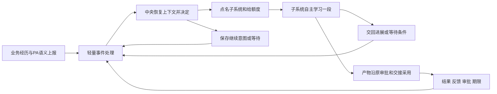

# Trylo 中央学习运行周期机制研究与讨论稿

> 状态：草案。
> 日期：2026-11-04，Asia/Shanghai。
> 用途：与产品所有者讨论运行周期的核心机制，讨论后形成施工目标。
> 依据：本对话已确认的学习意志、现有人脑学习报告、原论文与官方工程文档，以及当日约23:09起读取的施工中源码。当前集成仍在变化，以下源码结论是设计输入，不是本轮集成验收结论。

建议让中央学习拥有独立、可恢复的学习上下文，以有意义的事件和明确的继续学习意图推进。中央一次选定对象、目标和投入，子系统自行学习到合适交接点。中央等待时停止模型计算，运行宿主继续接收消息；需要新判断时再恢复。一次用户任务、一次中央决策、一次子系统学习阶段可以有不同长度。

这延续所有者已经确认的三点：中央可以有自己的智能体与loop；子系统封装为简单可调度能力，内部自主运行；业务与学习可以并行，正常改进在交接点生效。运行周期需要补齐的是这些角色怎样随时间协作。

## 1 当前实现能承接什么

| 已有接点 | 当前源码事实 | 对运行周期的意义 |
| --- | --- | --- |
| [中央host](</D:/CC/trylo/new trylo cli/src/internal/integration/central-learning/host.ts:38>) | 提供nominate、refresh、focusIssue、run和resume；run准备候选、联合决策、拨款派发、观察及结算，没有常驻timer或自主轮询 | 可保留为单次中央处理能力，由新运行周期组织调用 |
| [五域执行接口](</D:/CC/trylo/new trylo cli/src/internal/integration/central-learning/contracts.ts:53>) | nominate、prepare、dispatch、observe，已有原问题、阶段、策略、grant绑定 | 继续复用；只补必要的交接、等待和恢复信息 |
| [派发实现](</D:/CC/trylo/new trylo cli/src/internal/integration/central-learning/dispatch.ts:46>) | 当前调用会await域dispatch，再observe | 后台宿主需管理进行中的派发；不能把长阶段挂在用户工具调用上等待，也不能只去掉await便丢失结果归属 |
| [当前回合装配](</D:/CC/trylo/new trylo cli/src/internal/surface/cli/central-learning-turn.ts:152>) | beforeTask和afterTask提名、刷新；模型通过central_learning继续内容和决策；close关闭这次装配 | 内容处理与恢复仍借助任务回合。独立周期需要可跨回合的上下文和运行宿主 |
| [总集成记录](</D:/CC/trylo/new trylo cli/docs/02-分期工程产出/P05-Experience-Learning-V0.3/2026-11-04-中央总集成-正常入口与统一执行.md>) | 内容分析计业务任务，中央根预算限制正式学习worker | 新周期要明确中央模型思考的费用归属，不能把worker预算称为学习全部费用 |
| [冷启动与反馈决策](</D:/CC/trylo/new trylo cli/docs/02-分期工程产出/P05-Experience-Learning-V0.3/2026-11-04-实现与接线-中央冷启动及反馈决策.md>) | 最新方案已有阶段目标探索、经济收益建模和反馈后重算 | 运行周期负责在适当时间调用，避免再做一套选题和分配算法 |
| [既有daemon](</D:/CC/trylo/new trylo cli/src/internal/adapters/daemon/scheduler-loop.ts:17>) | 管理定时任务、lease和唤醒；当前把发生项交给原会话队列 | 可借其宿主管理设施。直接把学习塞进用户会话队列，会继续受前台空闲时机限制，尚不构成独立学习周期 |

旧的通用LearningScheduler具有入队与tick能力，但这不能单独代表当前五域中央执行链。具体运行宿主应围绕最新中央host设计，不能仅因旧文件叫scheduler便恢复为主实现。

## 2 研究给出的具体机制

**认知控制能够学习自己的投入方式。** Lieder等人的LVOC模型根据情境、控制选择、收益、响应时间更新价值预测，并通过类似Thompson sampling的方式兼顾探索。其控制成本包含计算与时间机会成本。对Trylo的启发是：中央重新思考也需要付出成本，不能每来一个事件都完整重算；模型与算法可以合作选择投入。论文是认知计算模型，参数不能直接移植为token价格。[论文正文与公式](https://pmc.ncbi.nlm.nih.gov/articles/PMC5937797/)

**中央可以选择持续一段时间的行动。** Options框架把行动表示为启动条件、内部策略和终止条件，允许行动持续可变时间。Trylo的一次“让工作流子系统调查并改进这次交接”具有类似形状：中央选择这一段，内部每步由子系统控制。这里只借用时间抽象与交还控制的组织方式，不要求给每个子系统训练一个强化学习策略。[Sutton、Precup、Singh原论文](https://people.cs.umass.edu/~barto/courses/cs687/Sutton-Precup-Singh-AIJ99.pdf)

**没有新外部输入，也可能继续学习。** Buch等人的人类运动序列实验发现，短暂清醒休息期间的回放与技能巩固相关，提示外部执行与内部整理可以交替发生。实验中的休息长度和回放速度不能作为软件定时器参数。[作者稿](https://pmc.ncbi.nlm.nih.gov/articles/PMC8259719/)

**预先处理已有上下文有工程价值，但要面向可能用途。** Sleep-time Compute通过模型反复改写、提炼上下文，并用显式结束工具停止；研究显示效果与未来问题的可预测性相关。其软件案例主要测量修改文件集合的F1，不能据此声称完整软件正确性得到提升。Trylo可以让已获准课题在业务间隙继续比较与提炼，不能由此推导出闲时全库扫描。[论文方法、讨论和附录K](https://arxiv.org/html/2504.13171v1)

**后台记忆处理已经有产品化实现形态。** Letta当前文档描述了后台子智能体整理近期对话，触发可按完成步数或上下文压缩配置。Trylo可借鉴前台与后台上下文分离；是否学习仍应由现有语义机会与中央决策决定，不直接复制固定步数作为学习价值判断。[Letta官方文档](https://docs.letta.com/configuration/memory)

**等待和恢复可以不占模型计算。** Temporal把异步消息、只读查询和需结果的更新分开，并用事件历史重建运行状态；重放使用已有活动结果。LangGraph保存中断状态，再由外部输入恢复，同时明确提醒恢复可能重跑节点，副作用需要幂等或拆开。Trylo可以在原Board上表达等待和恢复，并沿原grant/claim处理实际执行。这里借鉴机制，不建议直接引入这两个框架。[Temporal消息](https://docs.temporal.io/encyclopedia/workflow-message-passing)、[重放](https://docs.temporal.io/workflows)、[LangGraph中断](https://docs.langchain.com/oss/javascript/langgraph/interrupts)

## 3 建议采用的三个时间尺度

### 事件处理

PA、业务执行、子系统和原审批服务发布已有事实及语义上报。轻量运行宿主关联问题、合并同一问题的连续更新、更新等待条件，再决定哪些事情需要进入中央决策。

这一层理解事件身份和状态变化，不根据错误码硬写学习课题。模型钩子仍负责表达“哪里值得学”；重复计数只是材料。

### 中央决策回合

中央有独立的学习上下文，看到本次变化、仍未解决的问题、正在执行的阶段和可用预算。它可以读取材料、询问子系统的阶段准备情况、调用现有决策算法、启动或继续一段学习，以及登记等待或结束投入。

中央不必每个回合都调用LLM。例如预约结算已明确释放额度，可以先更新事实；只有需要理解新问题、选择处理方向或解释冲突时才进行语义分析。已经形成且仍有效的下一步也可以直接通过原执行合同推进。

### 子系统学习阶段

中央发出简单信号：针对哪一个问题、当前目标、可用投入，以及必要的来源/恢复引用。子系统使用自己的方法、工具与内部loop推进，直到完成这一段、等待依赖、需要中央选择或额度不足。

交还控制的依据是意义明确的边界。一次模型调用结束不自动等于该阶段结束，经过固定几秒也不自动要求中央介入。金额、调用上限和取消能力仍由原执行设施约束。



图中的循环可跨越多次用户任务。保存等待不会立即反向产生新一轮模型调用。

## 4 一次学习怎样持续下来

建议以已有issue为问题身份，补齐需要持久保留的“当前学习意图”，不要另外复制一套工单生命周期。它需要表达：当前要改善什么、已有认识和剩余问题、最近消费到哪些事实、正在执行的原阶段与grant、下一步及何时应重新判断。

保存的是公开工作摘要、结论、来源和动作记录，不依赖保存模型隐藏思维过程。恢复时按需读取相关材料；中央无需每次复读全部任务日志。

一个典型过程是：

1. 大任务出现反复交接返工，成员语义上报，PA确认已有配置没有解决问题，聚焦为学习机会。
2. 中央安排协作子系统调查，业务继续。子系统自主比较分工与材料流转，得到一个改进方向。
3. 如果已有工具足够，子系统形成协作经验；如果需要工具能力，留下原依赖请求。中央可以继续处理其他机会。
4. 用户同意所需动作、工具准备好后，原依赖状态改变，唤醒这一个问题；恢复原阶段和预算关系。
5. 改进在合适交接点进入对应专家，生成产物后结束本次主动计算，保留后续使用的反馈关联。
6. 下次使用发生返工或用户纠正，反馈唤醒原问题，保留旧版本和既有知识，决定修订或继续调查。

“当前无需继续花钱”“问题已经解决”“产物被批准”“长期有效”分别有自己的含义。中央可以停止主动计算，同时等待真实使用；无需让模型一直挂到效果得到证明。

## 5 唤醒与停止的算法形状

### 先判断什么发生了变化

一次重新判断的依据包括相关证据、阶段进展、依赖、授权资源、用户目标和实际业务窗口。Board全局序号增加本身不够：无关子系统记了一条日志，不应令所有课题重新思考。

中央保存本问题最近消费的相关版本，以及等待的事实或时间条件。事件命中后读取最新事实，再判断是否可推进。事件通知只起提示作用；宿主重启后可以用原持久事实和游标补查，避免完全依赖一次内存通知。

时间条件用于已知用途期限、未来交接、恢复条件或用户安排。到点意味着需要重看当前情况，不意味着自动获得预算、依赖已经完成，或必须做一次完整模型分析。宿主离线时无法保证准时计算，重启应重新计算仍有意义的事项。

### 允许无新事件的继续思考

如果子系统仍有获准投入，并能继续尝试有明确作用的计算、检索、比较、编译或候选改进，它可以继续。相同外部材料经不同处理产生新知识，本身就是学习。

若当前下一步需要中央重新分配资源，子系统交回已有进展、剩余问题和下一步预期作用。中央使用现有模型评估继续投入。不能只凭模型一句“还可以继续”无限续费，也不能把“外部数据没变”当成禁止内部探索的条件。

重复付费应以“同一材料、同一处理意图、同一完成状态被无理由重放”识别。不同处理方向和明确的内部进展仍可构成继续依据。进展不能由文本长度、文件数量或自报置信度单独认证。

### 把继续控制作为一种有成本的选择

候选形式可以沿用半马尔可夫决策理解：在状态b下选择一段行动a，该段持续τ，之后得到新认识b′。

```text
Q(b, a) = E[本段价值 - 本段成本 + d(τ) · V(b′)]
```

这是设计表达，不是本轮新增可运行算法。b包含当前信息与不确定性，a可以是继续某段学习、换对象或等待。有限窗口目标可以使用d(τ)=1，并在实际用途/截止模型中处理时间，避免再重复扣一次时间损失。若引入时间折扣，其参数必须有明确目标解释。

更进一步，中央调用模型进行一次额外判断m，也可以作为待选计算：

```text
VOC(m | b)
  = E_y[max_a Q(b 经 m 得到 y 后, a)]
    - max_a Q(b, a)
    - 这次判断的增量成本
```

这个式子说明应比较“多想一次能改变什么决定”与其成本。初版没有可靠的y分布时，不应为每个事件捏造VOC小数；先结合语义判断、已有价值模型、真实调用成本和确定的变化条件推进。未来再从实际决策记录学习哪些唤醒有用。效用和token未建立换算时，token继续作为硬约束，不与概率或任务分数直接相减。

持续性包含两个不同机制：已有学习段内的自主推进，以及交接后的中央重判。二者都可继续，但不需要每个工具动作都经过中央。

## 6 中央的自主性与业务的稳态

PA继续代表用户，解释用户目标和偏好，过滤已经由普通业务解决的问题，并承担用户交流。中央拥有学习上下文和调度决策；子系统拥有学习过程；原Permission拥有授权。新学习周期不用另起一个与PA竞争的用户代表。

建议每个精确学习scope只有一个有效的中央决策所有者，避免CLI与Desktop分别为同一机会重复派发。中央提交决策可以串行，子系统执行可在预算、能力和依赖允许时并行。当前联合模型对同时行动的收益识别仍有限，不能把各域单独预测相加后声称并行全局最优；可以先沿现有分段规划逐次启动与重算。

普通优先级变化在子系统交接点处理。重要新信息先更新继续意图，使下一阶段使用新依据；明确取消、授权撤回或必须立即转向的情况通过原取消入口处理。已完成的外部副作用不因取消而回滚，未知费用也不能当作退款。

业务进行时，学习可以使用独立可用资源推进。用户交互与后台学习共享provider限额时，需要由宿主资源仲裁表达实时可用容量。前台暂时优先是一种资源安排，不能变成所有后台学习永远排队到任务结束。

预算耗尽时保留可恢复的学习意图，停止新增收费动作。重启、换回合、等待超时和新建issue都不自动补充原授权。中央自己的独立模型调用应进入可见的学习费用；可沿同一账本区分中央分析与子系统执行，不新增钱包。原PA共枪产生的附加信号仍按真实调用归属记录，不能声称能精确拆分不可测的token因果成本。

## 7 持续运行需要的最小接缝

对外仍可保持“提交信号、查看状态、请求暂停/继续”的简洁形状。内部应复用当前nominate/prepare/dispatch/observe，通过原身份关联补充阶段进展和等待条件，不统一规定各子系统内部步骤。

独立运行宿主还需要承接四件事：

- 保存相关事件消费位置及下一次等待条件，让中断后知道从哪里继续。
- 持有当前scope的有效运行所有权，实际写入仍经原Board writer；长期运行权不等于长时间占用文件写锁。
- 管理进行中的原worker调用及结果，不让一次长阶段阻塞中央接收新消息。
- 在恢复时区分未派发、已派发、已完成和结果未知，复用已有请求身份、claim和收据。恢复读取已完成结果；原副作用是否可重试由原执行所有者决定。

宿主可复用现有受管进程设施，中央学习会话应与用户对话会话分开。当前daemon只向用户会话排队的形状需要适配，不能直接宣称已有daemon等于已有学习运行周期。进程放在哪个已有host最合适，留到施工时结合现有Service Host和CLI生命周期定点确认，不为此引入Temporal服务或LangGraph存储。

关闭一个聊天窗口应结束该聊天的前台回合；已获准的学习意图保存在原scope。是否在整个应用退出后继续执行，服从已有后台服务的明确设置。运行周期本身不另行赋予常驻进程权限。

## 8 第一版怎样判定机制成立

先完成这些实际行为，再做针对性的检查：

1. 没有新用户输入时，已获准且有下一步的学习能跨回合继续。
2. 子系统等待一个具体工具或审批时，模型不空转；该依赖真的变化后恢复原学习。
3. 业务继续执行，普通改进在下一交接点生效；新消息能影响后续学习选择。
4. 同一事件重复到达、宿主重启，都不会使原阶段重新领钱或盲目重做已完成副作用。
5. 新反馈可以重开原问题并改变后续投入；停止当前计算不丢失这条关联。
6. 没有相关变化、没有可推进的学习段时，不发生反复付费判断；仍有内部探索价值时能够继续。

这些是运行行为，不要求先证明长期净收益，也不要求把本轮变成长时间压测工程。数学与已有子系统证据可复用，仅补新运行边界的必要检查。

## 9 接下来优先讨论的一件事

建议先确定中央一次交出控制的尺度：**默认让子系统在已获准的一段目标和额度内自主推进，到需要中央选择、等待外部条件或完成阶段时交还；普通事件更新待办，重要变化才提前介入。**

这个选择决定子系统自主性、中央调用频率、运行成本及恢复粒度。它与所有者“像大脑发一个信号”的想法一致，也能承接现有grant和真实stage。我们先用一个具体例子把这一段走通，再确定唤醒条件怎样表达、中央上下文怎样续接，最后形成实现目标。

## 10 研究与交付范围

本轮实际阅读了LVOC的价值与更新公式、Options的定义、清醒休息回放作者稿相关段落、Sleep-time Compute的方法/限制/工具附录，以及Temporal、LangGraph、Letta官方机制说明。Mattar与Daw的Need/Gain方向承接[2026-10-28既有报告](</D:/CC/trylo/new trylo cli/docs/99-施工调研/学习控制板/2026-10-28-人脑学习时机与学习控制板设计调研.md>)；本轮原站读取受限，没有把它作为新增公式的直接验证来源。

本文件新增的是机制讨论稿。没有改产品代码、既有算法、运行开关、额度或学习意志文档，没有启动常驻进程、付费模型调用或测试套件。
